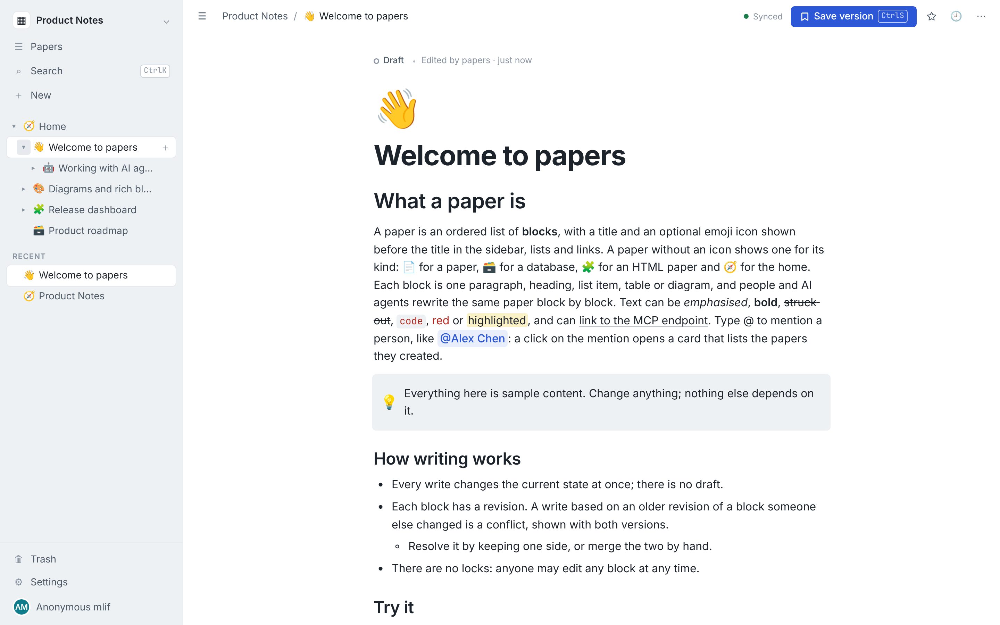
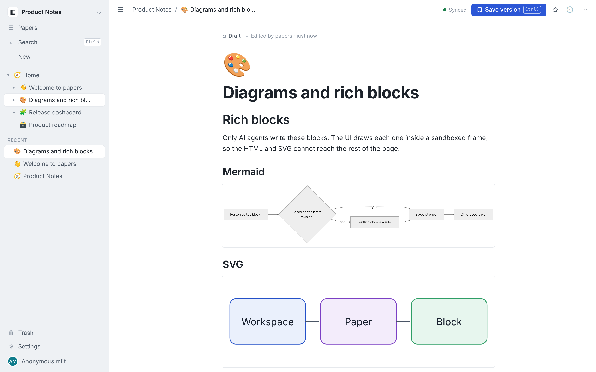
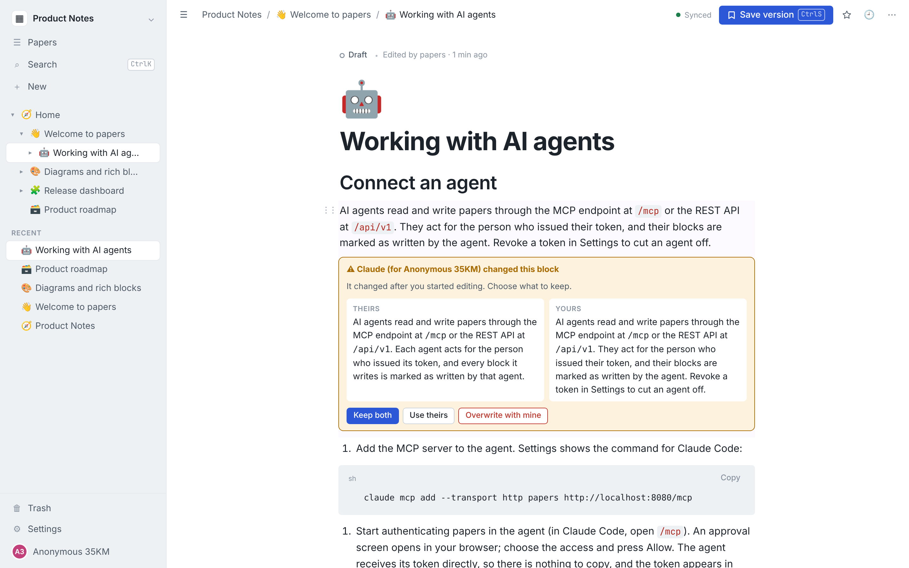
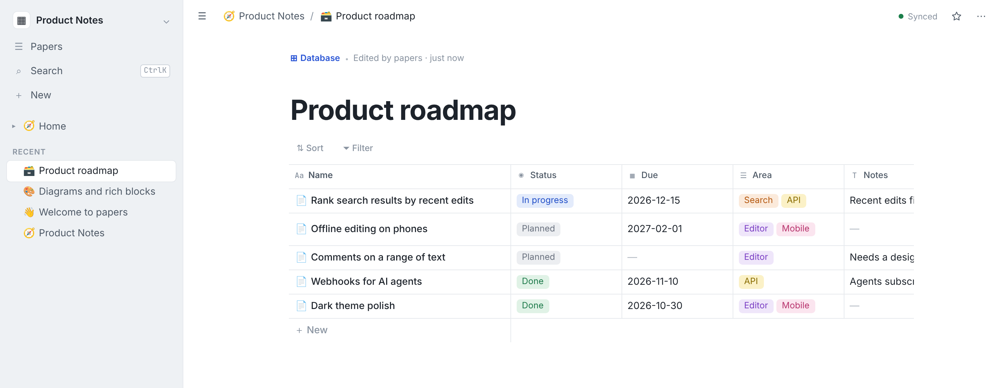

# papers

**A shared canvas where people and AI agents write the same papers, block by block.**

**[Try the demo](https://papers-240228871785.asia-northeast1.run.app)**: no sign-in needed. Everything in it is deleted every day at 04:17 JST, so do not keep anything there.



## What makes papers different

papers looks like the block editors you know: a sidebar of nested pages and a body of blocks. It is built for a different job: a team's knowledge, kept current by people and AI agents working on the same papers at the same time.

- **AI agents are writers, not plugins.** Agents read and write papers through the MCP endpoint and the REST API with the same operations people use. Every change records whether a person or an agent made it, and for whom.
- **Edit by block, with no locks.** Each edit names the revision of the block it started from. If someone else changed that block meanwhile, the edit is refused with both versions, and the writer keeps one, keeps both or overwrites. Nobody waits for anybody.
- **Versions are saved on purpose.** What anyone writes is the current state at once. A version (v1, v2, …) exists only when a person or an agent saves one, so the history is a list of states someone chose to keep, and any of them can be compared or restored.
- **Rich blocks written by AI.** Agents add Mermaid diagrams, SVG and self-contained HTML, even whole HTML papers. They run in a sandboxed frame, and people change only the values the agent marked as editable.
- **Connect an agent in one command.** `claude mcp add` and a consent screen in the browser: the agent receives its own token, with nothing to copy. Tokens are listed and revoked in Settings.
- **Workspaces are configuration.** One TOML file per workspace and a Rego rule decide who may use it. There are no roles, no administrators and no admin screens; a paper is public to the workspace or private to its creator.

## Features

- **Blocks**: paragraphs, headings, quotes, bulleted, numbered and to-do lists, callouts, code, dividers, images and tables. Type `/` at the start of a block or after a space to pick a type.
- **Inline formatting**: bold, italic, strikethrough, code, links, coloured and highlighted text, and `@` mentions of people.
- **Nested papers**: a paper placed in another paper's body becomes its child. Every workspace has a home paper, and the sidebar shows the tree.
- **Rich blocks and HTML papers** written by AI agents: Mermaid, SVG and HTML, drawn in a sandboxed frame.

  

- **Live editing together**: changes appear on every open screen as they are written, and a name tag shows who is editing which block.
- **Conflicts you can see**: when someone changed the block you are editing, papers shows their text and yours and lets you keep both, use theirs or overwrite with yours.

  

- **Databases**: a paper whose body is a table of items, with text, date, select, multi-select and person properties, sorting and filters. Each item is a paper of its own.

  

- **Versions**: save the current state as v1, v2, …, compare any two states and restore one.
- **Search** across the titles and blocks of a workspace.
- **Public and private papers**, favorites, emoji icons, archive, and a trash you can restore from.
- **Several workspaces**, each with its own rules for AI agents, grouped in the sidebar.

## Try it

1. **Open the [demo](https://papers-240228871785.asia-northeast1.run.app).** It holds the same sample papers as these screenshots; edit anything.
2. **Run your own server** ([Run your own server](#run-your-own-server)): a single binary, with in-memory storage for a try and Firestore for real use.
3. **Connect an AI agent** to it ([Connect an AI agent (MCP)](#connect-an-ai-agent-mcp)) and ask the agent to read or rewrite a paper while you have it open.

## Connect an AI agent (MCP)

The MCP endpoint is `/mcp`. The tools an agent uses most:

| Tool | What it does |
|---|---|
| `papers_guide` | Explains papers, block types, operations and the workspace's rules; agents call it once before writing |
| `papers_search` | Finds papers and blocks containing words |
| `papers_read` | Reads a paper's blocks with their revisions |
| `papers_create_paper` | Creates a paper, optionally from Markdown, or an HTML paper |
| `papers_write` | Applies a batch of operations based on those revisions; fails with a conflict when a block changed meanwhile |
| `papers_save_version`, `papers_versions`, `papers_diff` | Save, list and compare versions |

In no-authn mode the MCP endpoint needs no token:

```sh
claude mcp add --transport http papers http://localhost:8080/mcp
```

With sign-in enabled, add the same command without a header (Settings shows
it with the right URL) and start authenticating papers in Claude Code
(`/mcp`). papers is an OAuth 2.1 authorization server: the browser opens a
consent screen, and Claude Code receives an **AI agent** token (valid 90 days,
listed and revocable under *API tokens*). No token passes through the shell,
so none is left in its history. MCP clients without OAuth can still send a
token created under *API tokens* as `Authorization: Bearer pap_…`.

When MCP clients reach the server under another URL than browsers do, set
`--mcp-base-url`. For example, with IAP in front of
`https://papers.example.com` (`--base-url`) and a VPN route to the same
server at `https://papers-direct.example.com`, set
`--mcp-base-url https://papers-direct.example.com`: Settings then shows that
URL, the consent screen still opens on `--base-url` (where the browser has
its session), and a code made there is exchanged on either host. OAuth
metadata is answered only for the hosts of these two URLs. A client that goes
through IAP itself (another service connecting to `papers.example.com`) sends
its IAP token in `Proxy-Authorization` and the papers token in
`Authorization`.

## Run your own server

### Run locally

```sh
# terminal 1: API server, no sign-in, in-memory storage, example workspaces
task dev:server
# (= go run . serve --no-authn --ws-origin localhost:5173 \
#      --config examples/config --global-config examples/global.toml)

# terminal 2: Web UI with hot reload
cd frontend && pnpm install && pnpm dev   # http://localhost:5173
```

Or build a single binary that serves the UI itself:

```sh
task build && ./papers serve --no-authn --config examples/config   # http://localhost:8080
```

### Workspaces

```toml
# examples/config/security/security.toml — one file per workspace
[workspace]
id = "security"           # never change: the storage namespace
name = "Security Team"
description = "Runbooks and incident notes. Write steps as numbered lists."  # agents get this as the workspace's rules
emoji = "🛡️"
language = "ja"

[authz]                   # omit to let every signed-in user in
policy = ["security.rego"]  # relative to this file
```

Every `*.toml` file below the `--config` directory is a workspace, subdirectories
included, so a workspace's TOML and Rego files can share a directory
(`examples/config/security/`). Names starting with `.` are skipped and symbolic
links below the directory are not followed.

The policy is Rego in package `papers.authz` defining a boolean `allow`; the
input is `{"workspace": {"id"}, "user": {"id", "email", "domain"}}`. Decisions
are cached for 60 seconds; an error denies. Everything is validated at
startup and a bad file stops the server. `--global-config` groups workspaces
in the sidebar (see `examples/global.toml`).

## Configuration

Every flag can also be set through the environment variable next to it.

| Flag / env | Default | |
|---|---|---|
| `--config` / `PAPERS_CONFIG` | | Directory of workspace definitions (required) |
| `--global-config` / `PAPERS_GLOBAL_CONFIG` | | Display groups of workspaces |
| `--addr` / `PAPERS_ADDR` | `:8080` | Listen address |
| `--base-url` / `PAPERS_BASE_URL` | `http://localhost:8080` | Public URL; OAuth redirect is `<base>/api/auth/callback`; `https` enables Secure cookies |
| `--google-client-id` / `PAPERS_GOOGLE_CLIENT_ID`, `--google-client-secret` / `PAPERS_GOOGLE_CLIENT_SECRET` | | Google OAuth client |
| `--google-hosted-domain` / `PAPERS_GOOGLE_HOSTED_DOMAIN` | | Account chooser hint (not an access control) |
| `--allowed-domain` / `PAPERS_ALLOWED_DOMAINS`, `--allowed-email` / `PAPERS_ALLOWED_EMAILS` | | Who may sign in at all (at least one is required with Google); workspaces narrow it further |
| `--session-ttl` / `PAPERS_SESSION_TTL` | `720h` | Browser session lifetime (also of anonymous sessions) |
| `--anonymous` / `PAPERS_ANONYMOUS` | `false` | Anyone may use papers without signing in: a browser without a session becomes a new anonymous user. Cannot be combined with Google sign-in or `--no-authn` |
| `--no-authn` / `PAPERS_NO_AUTHN` | `false` | Development only: every request is the dev user |
| `--dev-user-email` / `PAPERS_DEV_USER_EMAIL`, `--dev-user-name` / `PAPERS_DEV_USER_NAME` | `dev@localhost`, `Developer` | The dev user of `--no-authn` |
| `--enable-mcp` / `PAPERS_ENABLE_MCP` | `true` | Serve `/mcp` and the OAuth endpoints for MCP clients |
| `--mcp-base-url` / `PAPERS_MCP_BASE_URL` | `--base-url` | Public URL where MCP clients reach this server, when it differs from `--base-url` |
| `--ws-origin` / `PAPERS_WS_ORIGINS` | | Extra Origin hosts allowed for WebSocket (Vite dev server) |
| `--repository-backend` / `PAPERS_REPOSITORY_BACKEND` | `memory` | `firestore` or `memory` (development only) |
| `--firestore-project-id` / `PAPERS_FIRESTORE_PROJECT_ID`, `--firestore-database-id` / `PAPERS_FIRESTORE_DATABASE_ID` | `(default)` | Firestore **Enterprise edition** database in Native mode. Run `papers firestore migrate` to create its indexes and TTL policies (see below) |
| `--firestore-search-language` / `PAPERS_FIRESTORE_SEARCH_LANGUAGE` | (detect) | BCP-47 language code of search queries, such as `ja` |
| `--event-buffer` / `PAPERS_EVENT_BUFFER` | `256` | Realtime events a watcher may lag behind before it is told to reload |
| `--attachment-backend` / `PAPERS_ATTACHMENT_BACKEND` | `memory` | Where images go: `gcs`, `dir` or `memory` |
| `--attachment-bucket` / `PAPERS_ATTACHMENT_BUCKET`, `--attachment-prefix` / `PAPERS_ATTACHMENT_PREFIX` | | Cloud Storage bucket and prefix for `gcs` |
| `--attachment-dir` / `PAPERS_ATTACHMENT_DIR` | | Directory for `dir` |
| `--max-ops-per-batch` / `PAPERS_MAX_OPS_PER_BATCH` | `300` | Operations per request (blocks per batch are capped at 240) |
| `--paper-touch-interval` / `PAPERS_PAPER_TOUCH_INTERVAL` | `1m` | How stale a paper's "updated" time may get before a write refreshes it |
| `--trash-retention` / `PAPERS_TRASH_RETENTION` | `720h` | How long papers stay in the trash |
| `--job-lease` / `PAPERS_JOB_LEASE`, `--job-poll` / `PAPERS_JOB_POLL` | `1m`, `15s` | When an instance stops, another takes its jobs over after the lease; `job-poll` is how often instances look |
| `--job-step` / `PAPERS_JOB_STEP` | `200` | Papers (or blocks of a copy) per transaction of a background job |
| `--sentry-dsn` / `PAPERS_SENTRY_DSN`, `--sentry-env` / `PAPERS_SENTRY_ENV`, `--sentry-release` / `PAPERS_SENTRY_RELEASE` | | Error reporting to Sentry |
| `--log-level` / `PAPERS_LOG_LEVEL`, `--log-format` / `PAPERS_LOG_FORMAT`, `--log-output` / `PAPERS_LOG_OUTPUT` | `info`, `console`, `stdout` | Logging |
| `--log-quiet` / `PAPERS_LOG_QUIET`, `--log-stacktrace` / `PAPERS_LOG_STACKTRACE` | `false`, `true` | No log output; stack traces in console logs |

Trash, restore and archive of a subtree, and moves across workspaces, run as background jobs that continue on the instance after the response, so on Cloud Run allocate CPU always (`--no-cpu-throttling`); otherwise they still finish, but only when an instance looks for them.

A test checks that every flag of every command has a `PAPERS_*` environment variable (see `papers serve --help`).

### Firestore database

`papers firestore migrate` makes the database match what papers needs: it creates the missing indexes and TTL policies and waits until the indexes are ready, so the server can start right after it. It is safe to run on every deploy; a database that is already up to date sees no change. Each index and TTL policy is reported on one line (`ready`, `creating`, `created`, `failed`, `unmanaged`, ...), and an index that needs repair makes it exit with an error.

| Flag / env | Default | Meaning |
|---|---|---|
| `--dry-run` / `PAPERS_DRY_RUN` | `false` | Only read, and report what would be created or deleted |
| `--no-wait` / `PAPERS_NO_WAIT` | `false` | Do not wait for the indexes to become ready |
| `--wait-timeout` / `PAPERS_WAIT_TIMEOUT` | `30m` | How long to wait for the indexes to become ready |
| `--prune` / `PAPERS_PRUNE` | `false` | Delete indexes of the managed collection groups that papers does not need (they are only reported otherwise) |

`papers firestore reset` deletes every document in the database, for example to start an environment over; indexes and TTL policies are kept. Stop the server first. It asks you to type `yes`; `--force-dangerous-apply` (`PAPERS_FORCE_DANGEROUS_APPLY`) skips the question, so never leave that variable set. With `FIRESTORE_EMULATOR_HOST` set it works on the emulator. Images in the attachment store are not deleted. With `--demo` (`PAPERS_DEMO`) it then creates each workspace's home and writes the sample papers of `pkg/usecase/sample/` into it (not the in-browser demo of `pnpm build:demo`); it reads the workspace configuration (`--config`, `--global-config`) and the attachment store (`--attachment-backend` `gcs` or `dir`, with the same flags and variables as `papers serve`) and stops before deleting anything when they are missing or invalid. It prints one line per workspace: `seeded` with the number of sample papers, or `skipped` when someone wrote in the workspace while the reset ran.

Both take `--firestore-project-id` and `--firestore-database-id` (or `PAPERS_FIRESTORE_PROJECT_ID`, `PAPERS_FIRESTORE_DATABASE_ID`).

## Documentation

[docs/model.md](docs/model.md) is the source of truth for the model and its terms.
[docs/design.md](docs/design.md) covers the architecture and the Firestore
layout, and [docs/codebase.md](docs/codebase.md) is a tour of the code.

## License

Apache License 2.0. See [LICENSE](LICENSE).
