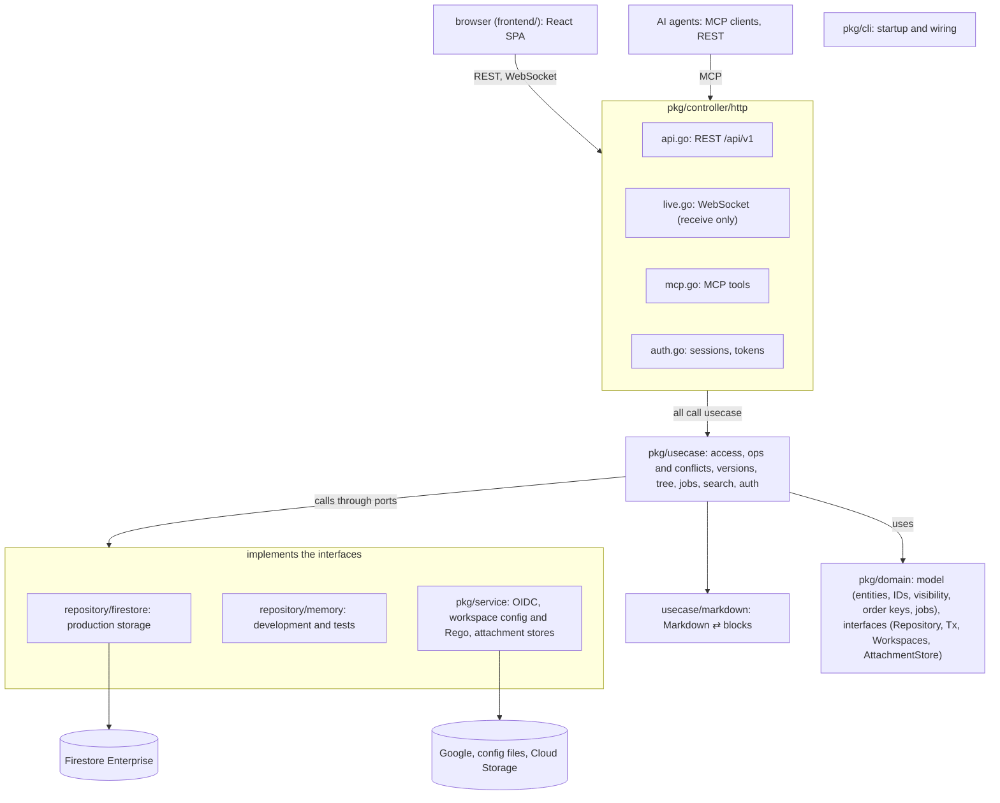
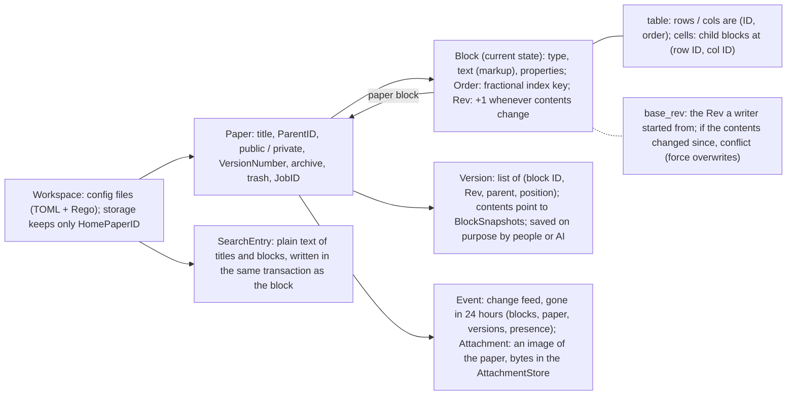
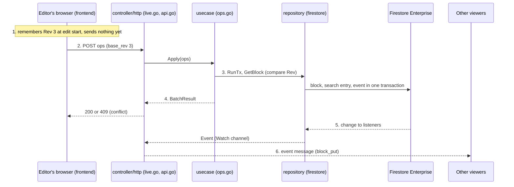

# papers codebase map

A shared canvas where people and AI rewrite the same papers block by block. One Go server serves the Web UI, REST, WebSocket and MCP, and stores everything in Firestore Enterprise.

As of 2026-11-22, branch `initial-implementation` (after the model was rebuilt). The source of truth for the model is [model.md](model.md), the implementation design is [design.md](design.md). This page is a map to read before the code.

## Shape

There are three ways in and one destination: the browser and the AI both end up calling the same `usecase` methods, which also check access, once.

| Entry             | Used by                        | Code                              | What it does                                                                         |
|-------------------|--------------------------------|-----------------------------------|--------------------------------------------------------------------------------------|
| Web UI            | People                         | `frontend/` → `api.go`, `live.go` | A React SPA embedded in the server binary                                            |
| REST `/api/v1`    | People (through the UI) and AI | `controller/http/api.go`          | Workspaces (read only), papers, batches, versions, tree, search, attachments, tokens |
| WebSocket `/live` | Pages with a paper open        | `controller/http/live.go`         | Receives others' changes only (server to client)                                     |
| MCP `/mcp`        | AI agents                      | `controller/http/mcp.go`          | Nine tools such as `papers_read`, `papers_write` and `papers_save_version`           |

Roughly 14,000 lines of Go (about 5,500 of them tests) and 6,000 of frontend. Configuration is the `--config` directory (TOML and Rego per workspace); examples are in `examples/`.

## Layers and packages

Calls go from top to bottom; a lower layer knows nothing of the layers above. Storage and external services hide behind the ports in `domain/interfaces`, so the use cases do not know which database they run on.Press a box to read about that layer.

*Arrows are calls; the bottom group implements the interfaces. pkg/cli only wires repository → usecase → controller at startup and does not appear while requests run.*

## Core concepts

There are few nouns to learn. Workspaces live in configuration files; storage only records their home. A paper is a list of blocks, and a child paper is a paper block in its parent's body. What is written becomes the current state at once; a version exists only when someone saves one. Concurrent editing is protected by each block's Rev, not by locks.

*The same nesting as storage: in Firestore these are the subcollections workspaces/{ws}/papers/{p}/blocks/{b}, …/versions/{n}, …/snapshots/{b}\_{rev} and …/events/{id}. The paper tree is not a path but the value of ParentID.*

| Name                    | In a word                                                                                                                           | Defined in                               |
|-------------------------|-------------------------------------------------------------------------------------------------------------------------------------|------------------------------------------|
| Principal               | The user making the request and the token they used (read-only or not, which workspaces)                                            | `model/principal.go`                     |
| Workspaces              | The workspaces read from configuration, and the Rego deciding who may use them (cached for 60 seconds)                              | `service/workspace`                      |
| Actor                   | Who wrote a block or a version: a person, an AI (with the user it acts for) or the system                                           | `model/actor.go`                         |
| Op / batch              | The list of ops sent in one request; all or nothing. New blocks, rows and columns are referred to by `ref`                          | `usecase/ops.go`                         |
| Job                     | A background job: work on a whole subtree, or a move across workspaces, in transactions of 200 papers; any instance can continue it | `usecase/job*.go`                        |
| Conflict                | An op whose base Rev is older than a change by someone else. The whole batch returns 409 with the current state                     | `usecase/ops.go`                         |
| Version / BlockSnapshot | A version saved on purpose, and snapshots of only the blocks that changed                                                           | `model/version.go`, `usecase/version.go` |
| markup                  | The markup of block text (Markdown + `[text]{.colour}`): normalizing, validating, plain text. A twin in TypeScript                  | `domain/markup`, `frontend/src/markup`   |
| Order key               | A string key that always fits between two siblings, so inserting never rewrites other blocks                                        | `model/order.go`                         |

## The journey of one edit

From a person rewriting one block to it appearing on someone else's screen, with no locks. The step buttons highlight the arrows of each stage.

*Dashed arrows are the way back. When an AI writes with MCP's papers_write, only step 2 becomes MCP; from step 3 on the path is exactly the same, and on a conflict the AI also gets the current contents back. No version is made here (saving is a separate operation).*

Overview

1 Start editing

2 Send

3 Apply

4 Store

5 Answer

6 Fan out

## Other flows

### Startup

`papers serve` reads the configuration directory (validating the TOML and compiling the Rego; any invalid file stops the start) and wires storage, the attachment store, the use cases and the controller, in that order. `UseCases.Init` creates each workspace's home (exactly one, however often the server starts). Background loops purge the trash older than 30 days every hour and take over background jobs whose instance stopped.

### Opening a paper

`GET …/papers/{p}` returns the paper and its breadcrumbs, `/blocks?limit=200` the first range, and the rest is read with the cursor. The children that paper blocks in a range point to come with it in one batch read. Then the `/live` WebSocket connects, a `hello` arrives, and the change feed flows from there. `/status` tells the page to show "Changed since v3".

### Saving and going back to versions

"Save version" is `SaveVersion`: nothing happens when nothing changed since the latest version; otherwise only the changed blocks get snapshots, the version is written and `VersionNumber` moves on. "Go back to this version" is `RestoreVersion`: the current state is set to the version, and children that moved elsewhere are not brought back. Before going back, the page checks for unsaved changes.

### Signing in

`/api/auth/login` redirects to Google, and `/callback` verifies the ID token (nonce and JWKS). The allowed domains and emails limit who gets in; each workspace's Rego decides who may use it. An AI sends a `pap_…` token, issued in Settings, as a Bearer token; MCP accepts nothing else.

### Search

`Search` passes the words to `Repository.Search`, reads the papers of the hits in one batch, and drops what the caller may not see, what is trashed, what a move is working on and what is archived. "Under this paper" walks up the parents one level at a time with batch reads. Search entries hold the plain text without markup and are written in the same transaction as the block.

### An AI writes

An agent reads the workspace's rules and the home's text with MCP's `papers_guide`, gets Revs with `papers_read` (papers may be given by path), and writes with `papers_write`. At a good point it saves a version with `papers_save_version`. Only AI writes HTML, SVG and Mermaid blocks; the UI only renders them in a sandboxed iframe (`RichFrame`).

## Frontend

There is no state management library. The state of the open paper is updated by the pure functions of `api/paperState.ts`. A block with an older Rev is ignored, so the answer to an op and the change feed can bring the same change twice without harm. Text is edited per block with Tiptap (`RichEditor`); what crosses blocks (Enter splits, Backspace at the start joins, pasting several paragraphs) becomes papers ops. A new block shows at once under a temporary key, with the order key the server will pick, and the edit moves to the server's ID when the answer comes. Sends run one after another, each based on the Rev the one before produced. Undo sends inverse ops (`editing/history.ts`) and stops when someone else changed the block since.

| Where                   | What it does                                                                                                                                                                                                                                                                                       |
|-------------------------|----------------------------------------------------------------------------------------------------------------------------------------------------------------------------------------------------------------------------------------------------------------------------------------------------|
| `src/api/`              | The REST client (`client.ts`: 409 conflicts, `moved` and `ambiguous` become an `ApiError`; a 401 sends the page to sign-in), the WebSocket (`live.ts`), the paper state (`paperState.ts`: Rev, table rows and columns, presence), types (`types.ts`)                                              |
| `src/markup/`           | The TypeScript markup (`markup.ts`, passing the same `cases.json` as Go) and the conversion to and from Tiptap documents (`tiptap.ts`)                                                                                                                                                             |
| `src/pages/`            | The paper page (`PaperPage`: temporary keys, the Rev an edit started from, conflicts, undo, one-click save, the history drawer, versions and restore, printing), the papers list (`PapersPage`), trash, settings (tokens, MCP example, theme, language, shortcuts), sign-in and the workspace chooser |
| `src/components/`       | Blocks (`BlockView`, `RichEditor` with its floating format bar, `TableBlock`, `SlashMenu`, `blockTypes`, `spacing` for the gaps between blocks), `ConflictPanel`, `HistoryDrawer`, `MoveDialog`, the sidebar (papers list, search, new, home tree, favorites, recent, trash), the `Palette` (Mod+K), `RichFrame`, `Mermaid` |
| `src/editing/`          | The undo history: what each send changed, and the inverse ops                                                                                                                                                                                                                                      |
| `src/ui/`               | Popovers, menus, modals and toasts                                                                                                                                                                                                                                                                 |
| `src/utils/`            | Keyboard (the platform's primary modifier, IME), order keys, preferences (theme, language), actors                                                                                                                                                                                                 |
| `src/i18n/`             | English and Japanese. Every text on screen goes through it                                                                                                                                                                                                                                         |
| `src/mock/`             | An in-browser server for the demo; `pnpm build:demo` builds a version that runs without a server                                                                                                                                                                                                   |
| `src/styles/global.css` | Tokens for colours, spacing and sizes, and the markup palette. No other literal values are written                                                                                                                                                                                                 |
| `e2e/`                  | Playwright end-to-end tests of the user flows against the built server (`task test:e2e`)                                                                                                                                                                                                           |

## Promises kept

Only the ones easy to break when changing code. The full list is in `CLAUDE.md`.

- **Access is checked in the use cases, through the Principal.** Whoever may not see something is told it does not exist (404), so its existence does not leak. Only writes with a read-only token get 403.
- **The server issues every ID.** No ID is chosen by a client. Something new is referred to within its batch by `ref`.
- **The server keeps no state in memory.** Several instances run on Cloud Run. Only per-connection state and the configuration (read at startup) are allowed. The change feed relies on Firestore listeners.
- **No locks; revisions protect.** update and delete require the base Rev, and a conflict is refused once. The UI sends the Rev an edit started from.
- **The system never makes versions on its own.** Only the save operation makes one.
- **The paper document is not written on every write.** Its updated time moves at most once a minute; contents live on blocks.
- **A new query needs its index.** Add it to `RequiredIndexes` in `indexes.go`; `papers firestore migrate` creates it (`migrate.go`). `reset.go` empties a database for `papers firestore reset`.
- **Reads are batched.** Child papers, favorites and search hits are read with one `GetPapers`; the papers list reads its parents with one `GetPapers`, and the workspace list reads every "continue" paper with one `GetRecents` and one `GetPapersIn`. Use-case tests count reads.
- **AI-written HTML/SVG renders only inside RichFrame.** Block markup is rendered as React elements, never inserted as HTML.
- **Storage contract tests run on both implementations.** `pkg/repository/*_test.go`. The markup cases run in both Go and TypeScript.
- **Documents in the repository are Markdown, in English.** The model's source of truth is [model.md](model.md); the implementation design is [design.md](design.md). Designs under discussion are shown as specs on claude.ai, not kept in the repository.

## Reading order

To get the picture in an hour, open these in order.

1.  [model.md](model.md) — what is handled and how (the source of truth).
2.  `pkg/domain/model/block.go`, `paper.go`, `version.go`, `principal.go` — what is stored, and who sees what.
3.  `pkg/domain/interfaces/repository.go` — what storage must provide. `Tx` and `Watch` are the core.
4.  `pkg/usecase/ops.go` — `Apply`, the `applier` and `checkBase` (conflicts): the heart of the product. Then `version.go`, `tree.go` and `job.go`.
5.  `pkg/repository/memory/paper.go` → `firestore/paper.go` — the same contract implemented twice.
6.  `pkg/controller/http/live.go` and `frontend/src/pages/PaperPage.tsx` — both ends of the realtime path, and the conflict and version screens.
7.  `pkg/controller/http/mcp.go` — papers as an AI sees it.

**Not there yet** (open questions in [design.md](design.md)): sharing listeners within an instance, checking search and indexes on a real Firestore Enterprise database, inviting people to private papers.
