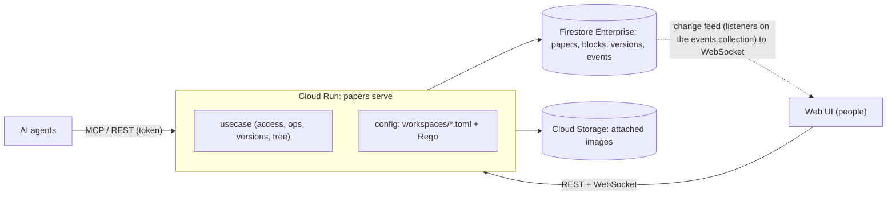
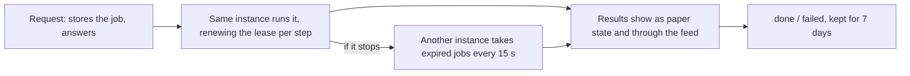

# papers design

Last updated 2026-11-22 (the rebuilt model as implemented: workspaces from configuration files with Rego, public / private papers, the paper tree, current state and versions, conflicts by revision, tables with row and column IDs, coloured markup, attachments, background jobs). Repository m-mizutani/papers.

> Terms, entities and rules are defined in [Model and concepts](model.md), the source of truth. This document describes how they are implemented: the write path, the storage layout, the change feed, authorization and operations. Where the two disagree, the model wins. For reading the code, see the [codebase map](codebase.md).

## Decisions

- **Workspaces are defined in configuration files**One TOML file per workspace in the `--config` directory. A Rego rule in `[authz]` (`data.papers.authz.allow`) decides who may use it; with no rule, every signed-in user may (warned at startup). Decisions are cached for 60 seconds, and a decision that cannot be made denies. Neither the UI nor the API can create or change a workspace.
- **No roles; a paper is public or private**A public paper is for everyone who may use the workspace; a private one only for its creator (for an AI, the user it acts for). Deleting, restoring and purging are the creator's alone, and only when everything under the paper is theirs too; others archive. There are no system administrators.
- **Every ID is a server-issued UUID v4 in base62 (22 characters)**Incoming IDs are checked for the format and for v4; anything else is 404. A new block is referred to within its batch by `ref` and `after: "ref:n1"`, and the answer maps each ref to its ID.
- **The current state, and versions saved on purpose**Commits, change history and per-block versions are gone. A block keeps only an internal revision (`Rev`, +1 whenever its contents change). A version is the paper's list of (block ID, Rev, parent, position) plus a BlockSnapshot of each block that changed. People and AI save versions; the system never does.
- **Conflicts are judged by the base revision, and stop the write**No base or base \> current: 400. Base = current: applied. Base \< current: conflict (force overwrites). Updating a block someone else deleted: conflict, even with force. Blocks created in the same batch are not checked. If any op conflicts, nothing is written and the 409 lists every conflict.
- **A child paper is a paper block in its parent's body**A paper keeps only its parent (`ParentID`). A move writes three documents. A move to another workspace copies, trashes the originals and leaves forwards.
- **Work on a whole subtree, and moves across workspaces, are background jobs (2026-11-22)**Trashing, restoring and archiving a subtree, and moving across workspaces, run as a `Job` split into transactions of 200 papers. The request stores the job and answers at once; the same instance runs it, and another instance takes it over once its 60-second lease ends (there is no API to read a job). The 500-paper limit on a subtree is gone. A move makes the originals read-only with `Paper.JobID` and keeps the copies hidden until they are complete.
- **Block text is Markdown plus coloured spans**`[text]{.red}` / `{.bg-yellow}`. Text is normalized and validated before it is stored, and search indexes the plain text. The server (Go) and the UI (TypeScript) implement it twice and both pass `testdata/markup/cases.json`. The UI edits each block with Tiptap.

## Overview

*Every write comes through REST or MCP into the use cases, and one Firestore transaction writes the current state, the search entries and the events. The UI receives changes from listeners on the events. All state is in Firestore (and Cloud Storage), so a client may talk to any instance.*

## Batches

`POST …/papers/{id}/ops` (MCP: `papers_write`) takes a list of ops and `force`. The applier in `pkg/usecase/ops.go` applies them in one `RunTx` (a transaction over one workspace).

| Op                         | What it does                                                                                                                                                                                                                                                                                                                                  | Base revision |
|----------------------------|-----------------------------------------------------------------------------------------------------------------------------------------------------------------------------------------------------------------------------------------------------------------------------------------------------------------------------------------------|---------------|
| `insert`                   | Issues an ID and adds the block. A `table` also gets row and column IDs and its cells; a `paper` also creates the child paper. Text is normalized.                                                                                                                                                                                            | Not needed    |
| `update`                   | Changes the contents (type, text, properties), never the rows, columns or cell positions. Does nothing when nothing changes. The new Rev is the Rev before the batch + 1.                                                                                                                                                                     | Required      |
| `delete`                   | Deletes the block; a table loses its cells too. A paper block is not deleted by the batch: it starts a `drop` job, which deletes the block and trashes the child with its subtree when all of it is the caller's, and otherwise archives the child with its subtree and keeps the block. The block's removal arrives through the change feed. | Required      |
| `move`                     | Changes only the position (no new Rev, never a conflict).                                                                                                                                                                                                                                                                                     | Not needed    |
| `set_title`                | The last writer wins (D1).                                                                                                                                                                                                                                                                                                                    | None          |
| `insert_markdown`          | Turns Markdown into blocks and inserts them.                                                                                                                                                                                                                                                                                                  | Not needed    |
| `insert_row` and five more | Insert (with new cells), delete (with their cells; people editing them come back in `editing`, D3) and reorder table rows and columns.                                                                                                                                                                                                        | Not checked   |
| `move_paper` and others    | move_paper, set_visibility, save_version, restore_version, archive and unarchive act on the whole paper and are accepted only alone in their batch (each also has its own REST route).                                                                                                                                                        | Not needed    |

- **Limits**: 240 changed blocks, 3 MiB of text, and 5,000 blocks per paper (counted only when the batch inserts). The number of ops is `--max-ops-per-batch`.
- **What is written**: the blocks, the search entries (one per block; the title's is `_title`) and the events (one per block, plus one for the paper when it changes). The paper document is written only when the title changes or `UpdatedAt` is a minute or more old (D6).
- **Reads**: a Firestore transaction must read before it writes, so writes are staged and applied at the end, and reads return the staged writes on top of what is stored (`fsTx`).
- **UI**: a new block shows at once under a temporary key (`tmp:n`) and can be edited right away; the answer's ref map then gives it its real ID. The React key stays the temporary one, and the temporary block gets the order key the server will pick, so it neither moves nor loses the caret when the answer comes. An edit keeps the Rev it started from and is sent after a 0.7 second pause, when the caret leaves the block, or with a structural change (a split sends the update and the insert in one batch). Sends run one after another, each based on the Rev the previous one produced. A 409, or someone else's change to the block while something is unsent, opens the conflict choice for that block only; with nothing unsent, their change simply replaces the block.
- **Undo**: the UI records what each of its sends changed (grouped per edit session) and undoes by sending the inverse ops; a block deleted and brought back gets a new ID, which later steps follow. Undo stops, saying why, when someone else has changed a block since. Restoring a version clears the history.

## Versions

- **Save** (`SaveVersion`): when the blocks' (ID, Rev, parent, position) and the title equal the latest version, nothing happens. Otherwise only the (ID, Rev) pairs missing from the latest version get a `snapshots/{blockID}_{rev}`, `versions/{number}` is written with `Create` (of two writers taking the same number, one fails), and `Paper.VersionNumber` moves on. v1 turns a draft into a canonical paper.
- **Read**: one version and the snapshots it points to, read in one batch. `/latest` is the version numbered `VersionNumber`.
- **Diff**: the two sides (a version or now) are matched by (ID, Rev), and only the blocks that differ are read.
- **Restore**: blocks that exist now but not in the version are deleted (paper blocks by the delete rules); blocks in the version but not now come back with the same ID. A block that comes back gets Rev `max(snapshot Rev + 1, now in microseconds)`, so that an (ID, Rev) pair always names one content. Children that moved elsewhere, or are in someone else's trash, stay where they are and are listed in `not_restored`. A child that comes back from the trash is restored in the batch itself, and what was trashed with it by a `restore` job. There is no limit. This holds for an unfiled paper too (it then has those children). A purged child is listed as `missing`. `GET /versions/{n}` returns `children`: for each child paper of the version, `kept`, `from_trash`, `moved`, `trashed` or `missing`, read with one `GetPapers`, and the UI lists what comes back and what does not before restoring.
- **UI**: "Save version" (one click; people's saves leave `Note` empty, and AI writes one through MCP), the list of versions, a version (`/v/{n}`, `/latest`), the difference from now, and "Go back to this version". Before going back, `/status` tells whether there are unsaved changes, and the UI offers to save them first.

## Tree

- **Home**: at startup (`UseCases.Init`) each configured workspace gets `EnsureHome`: if `workspaces/{ws}` has no `HomePaperID`, the record and the home paper are created in one transaction. A stored workspace that is no longer configured only causes a warning.
- **Creating a child**: `insert paper` into the parent (`POST …/papers` with `parent` does the same). Unfiled and private papers have no children: inserting a `paper` block into one is `invalid_argument`.
- **Creating without a parent**: `POST …/papers` without `parent` (MCP `papers_create_paper` without `parent`) writes only the paper, public with an empty `ParentID`: an unfiled paper. Nothing is written to any body.
- **Moving**: at most three writes: the paper block removed from the old parent (none for an unfiled paper), one added to the new parent, and the paper's `ParentID`. The new parent must be the home or a filed paper, and a move without a parent is `invalid_argument` (an empty parent no longer means the home). Cycles are refused by walking up from the new parent (at most 100 levels).
- **Moving to unfiled**: `unfiled: true` on a move (not with `parent` or `workspace`), only when the paper has no children outside the trash: the paper block is removed from the parent's body and `ParentID` cleared, in one transaction.
- **Visibility**: making a private paper public places it under `parent` when one is given, and leaves it unfiled otherwise. A parent may be given by path (`ResolvePaper`; when a title is not unique the answer is `ambiguous` with the candidates).
- **Moving to another workspace**: a `move` job ([below](#background-jobs)). The paper and its subtree are copied with new IDs (the current state, the latest version as v1, and the attachments); the copy is attached, then the originals go to the trash and each leaves a forward (`forwards/{id}`). An old ID then answers `moved` (an error code in REST; the UI follows it).
- **Trash**: `DeletedAt` and `DeletedWith` (the paper whose deletion started it). Restoring brings back what has the same `DeletedWith`; when the parent is in the trash, the paper goes under the nearest ancestor that is not and can have children (or the home). A paper deleted while unfiled comes back unfiled. After 30 days (`--trash-retention`) an hourly task purges it with its attachments.
- **Subtrees**: everything that acts on a whole subtree (trash, restore, archive with the subtree) is a background job. A subtree is collected one level at a time through the parent index (`ParentID in [...]`, 30 at a time). There is no limit on its size.
- **Order of children**: the order of the paper blocks in the parent's body (`ListPaperBlocks`); the child papers are read in one batch.
- **Sidebar**: the home, favorites (children are read only for the open levels), the 10 most recently opened papers and `unfiled_count`, the number of the user's own unfiled and private papers that are not archived, in the trash or being moved. The count reads the same query as the papers list (`ListPapers`, unfiled and the user's, 100 at a time, at most 5 queries) and stops at 100 (shown as "99+"); there is no aggregation query. One request reads the workspace record, `ListFavorites`, `GetRecent`, one `GetPapers` (home, favorites and recent together) and at most 5 `ListPapers`, whatever the number of papers. `GetPaper` updates the recent list each time, and the UI reads the sidebar again after a paper has loaded.
- **Papers list** (`GET /workspaces/{ws}/papers`): Firestore filters only on "unfiled" (`ParentID == ""`) and "mine" (`CreatedBy.UserID`), ordered by `UpdatedAt` or `CreatedAt` descending (ties by ID), with a cursor of (time, ID). The use case asks for twice the page size, drops the home, papers in the trash or being moved, papers the caller may not see, the wrong visibility, archived papers unless asked, and filed or unfiled papers per `place`, and reads on until the page is full, at most 5 queries; it then answers with `next_cursor` (empty at the end). The parents' titles come from one `GetPapers`, so a page costs the queries plus one batch read.
- **Continue where you left off**: `GET /workspaces` adds `last_opened` to each workspace: the first paper of the user's recent list there and when it was opened. All the recent lists are read with one `GetRecents` and their papers with one `GetPapersIn` (across workspaces); a paper that is not visible, in the trash or archived gives `null`.

## Background jobs

`pkg/usecase/job.go` runs jobs (picking up, leases, retries); `job_*.go` hold the steps of each kind. Writes proportional to the size of a subtree are made only this way.

*Any instance can run any step. Progress is written to the job in the same transaction as the step, so a job that stops goes on from where it was.*

- **Storage**: `workspaces/{ws}/jobs/{job}`, and one `…/jobs/{job}/items/{paper}` per paper (depth, whether its children were collected, its stage, and for a move the copy's ID and how much was copied). A finished job's `ExpireAt` is set 7 days ahead and the TTL removes it.
- **Leases**: the running instance writes `LeaseUntil` (60 seconds) and its own ID (random per start), and renews the lease with every step. Each step checks the holder and the step counter again in its transaction and stops if the job moved on. Every 15 seconds `serve` looks in each configured workspace for unfinished jobs whose lease has ended and takes them.
- **Steps**: one step is one transaction over up to 200 items (or 200 blocks of a copy). **Collect** reads items whose children are not collected yet, finds the children in one query with `ParentID in`, and adds them as items. **Apply** reads items at the first stage in depth order, changes the papers, and moves the items on.
- **Retries**: `ErrInvalidArgument`, `ErrPermissionDenied`, `ErrNotFound` and `ErrBusy` are failures by rule: the job fails at once (and is rolled back where that is possible). Anything else is retried after 2 seconds, doubling up to 5 minutes, and fails after 20 tries.
- **Starting**: the request checks only what it can check at once, stores the job and answers; the instance that stored it runs it with `async.Dispatch`. A trash job that finds someone else's paper under the tree archives the tree instead (D18). Failures by rule (a target parent that went away, say) are only logged.
- **Copies of a move**: the IDs of copied papers, blocks and attachments are `model.DeriveID(job, original ID)` (UUID v4 shaped, from SHA-256). Repeating a step writes the same documents again, so no transaction has to span two workspaces. A copy's v1 is written in the paper's last copy step if it does not exist yet; attachments are written to the same key again.
- **Marks of a move**: collecting sets `JobID` on every original. Writes to a paper with a `JobID` (blocks, title, versions, moves, visibility, deletion, adding a child, moving something under it) get `ErrBusy` (409 `busy`). Copies are created with the `JobID` too. Papers with a `JobID` are dropped from search results (during the move the originals do not show either). Attaching clears the copies' marks and puts the copy of the root into the new parent's body; retiring trashes the originals, writes the forwards and clears their marks. A move that fails before attaching purges the copies (`PurgePaper`) and clears the originals' marks.
- **What users see**: there is no API to read a job. The UI rereads through the change feed. An original of a finished move has a forward, and opening it (even in the trash) answers `moved`.

## Feed and presence

The change feed is `papers/{id}/events`, short-lived records that a TTL on `ExpireAt` removes after 24 hours. Block puts and deletes, paper updates, saved versions and presence all travel the same way. `Watch` opens two listeners, a query on the events and one on the paper document (to learn about a purge), and returns after the first snapshot.

- The WebSocket only sends from the server (`hello` / `event` / `closing`); the UI reloads on every `hello`. A reader that cannot keep up has its channel closed and reconnects and reloads. When the paper changes, access is checked again; a reader who lost it gets `access revoked`.
- Presence is reported with `POST …/presence` (when editing starts, every 30 seconds, and `leaving` at the end), stored as an event and valid for 45 seconds. The UI shows names on the blocks being edited. Deleting rows and columns looks at recent presence and returns the people editing the cells that go.

## Authentication and authorization

### Authentication

Google OIDC (limited to the allowed domains and emails) with session cookies, and API tokens (`pap_{ID}.{secret}`, stored as a hash of the secret). `--no-authn` is for development.

`--anonymous` replaces sign-in for servers anyone may use. `authMiddleware` (`/api/auth/me`, `/api/v1/*`) checks, in order, a bearer token, the CSRF header of a cookie request, and the session cookie; when the cookie is missing, malformed, unknown or expired, it creates an anonymous user and a session (on Firestore three writes: the user, its email index and the session; no `Identity`) and sets the session cookie on the response. Because the CSRF check comes first, a forged request never creates a user. Static files, `/healthz` and `/mcp` (bearer tokens only) never create one. The UI waits for `/api/auth/me` before any other call, so a page load makes one user. Nothing is kept in memory: the cookie and the stored session decide who the browser is.

### Authorization

1.  Workspace: configured, within the token's workspaces, and `allow` by its Rego rule. The input is `{workspace: {id}, user: {id, email, domain, anonymous}}`.
2.  Paper: public, or for private and trashed papers the creator (`Principal.SeesPaper`).
3.  Writing: a read-only token gets 403. Everything not visible is 404.
4.  Creator only: changing visibility, deleting and restoring (with everything under it the creator's). The home cannot be deleted, archived, moved or made private.

A writer (Actor) is a person, an AI (a token of kind agent) or the system (creating homes). Writes with a personal token stay the person's and are shown as "via API" through `token_id` (D7).

## API and MCP

| REST (/api/v1/workspaces/{ws}…)                                                                                                                     | What it is for                                                                                                     |
|-----------------------------------------------------------------------------------------------------------------------------------------------------|--------------------------------------------------------------------------------------------------------------------|
| `GET /workspaces`, `/{ws}`, `/sidebar`, `/search?q&under`, `/trash`, `/resolve?path`                                                                | The usable workspaces (with `last_opened`) and their display groups, the sidebar, search, the trash (with `deleted_at`, `purge_at` and `below`, counted from the same list), resolving a path |
| `GET /papers?place&creator&visibility&archived&sort&limit&cursor`                                                                                   | The papers list: `place` unfiled (default) / filed / all, `creator` me (default) / all, `visibility` all (default) / public / private, `archived` false (default) / true, `sort` updated (default) / created, `limit` 1–100 (default 50), `cursor` from `next_cursor`. Invalid values are 400 |
| `POST /papers`                                                                                                                                      | Creating a paper (under `parent`, unfiled without one, or private outside the tree)                                |
| `GET /papers/{id}`, `/blocks?after&limit`, `/children`, `/markdown`                                                                                 | The paper and its breadcrumbs, a range of blocks (with the child papers read in one batch), the children, Markdown |
| `POST /papers/{id}/ops`                                                                                                                             | A batch                                                                                                            |
| `GET|POST /versions`, `GET /versions/{n|latest}`, `POST /versions/{n}/restore`, `GET /diff?from&to`, `GET /status`                                  | Versions (a version also says what restoring does with each child)                                                 |
| `POST /move`, `PUT /visibility`, `POST /archive|unarchive|trash|restore`, `PUT|DELETE /favorite`, `POST /presence`, `POST|GET /attachments`, `GET /live` | Tree (`move` takes `parent`, `after`, `workspace` or `unfiled`; `visibility` takes an optional `parent`), state, favorites (home and private papers are 400), presence, attachments, the feed. Work on a subtree starts a background job and answers |

MCP (`/mcp`, token required): `papers_guide` (the workspace's rules and the home's text), `papers_list_workspaces`, `papers_search` (limited by path), `papers_read` (`at` for a version, ranges, the outline only), `papers_create_paper`, `papers_write`, `papers_save_version`, `papers_versions`, `papers_diff`. Results carry the workspace's rules too, and a write says that it is not in a version yet.

## Firestore

    users/{userID}                      favorites/{ws}_{paper}, recents/{ws}
    emails/{base64url(email)} identities/{provider}/subjects/{sub}
    sessions/{id}  (TTL ExpiresAt)      tokens/{id}
    workspaces/{ws}                     HomePaperID (the workspace itself is configuration)
    workspaces/{ws}/papers/{paper}
      …/blocks/{block}                  current state
      …/versions/{0000000003}           versions
      …/snapshots/{block}_{rev}         contents the versions point to
      …/events/{auto}  (TTL ExpireAt)   change feed
      …/attachments/{id}
    workspaces/{ws}/forwards/{paper}    forwards of moves across workspaces
    workspaces/{ws}/jobs/{job}  (TTL ExpireAt)  background jobs
      …/items/{paper}  (TTL ExpireAt)   progress per paper
    workspaces/{ws}/search/{paper}_{block|title}

Enterprise creates no index by itself and runs a query without one as a full scan. Every query is listed in `firestore.RequiredIndexes`, and `papers firestore migrate` creates the missing indexes and TTL policies. The main ones: on papers, `ParentID` (children), the eight indexes of the papers list (`ParentID`, `ParentID + CreatedBy.UserID`, `CreatedBy.UserID` and none, each followed by `UpdatedAt desc` or `CreatedAt desc`), `CreatedBy.UserID + DeletedAt` and `DeletedAt` (trash); on blocks, `ParentID + Order` (range reads, insert positions) and `Type + Order` (order of children); `Number` on versions; `Event.At` on events; `SHA256` on attachments; `State + LeaseUntil` on jobs (expired leases); `Expanded + Depth` and `Stage + Depth` on items; and the full-text index on search.

The contract tests (`pkg/repository/*_test.go`) hold the memory and Firestore implementations to the same expectations. The Firestore side runs on the emulator or a real database (`TEST_FIRESTORE_PROJECT_ID`). Use-case tests count reads, for example that listing child papers takes one batch read.

## Search

A search entry is written per block (plain text without markup; for `html` and `svg`, the text nodes followed by the `props.fields` values) and per title, in the same transaction as the block. Search uses the Search stage of Firestore Enterprise on the workspace's collection, reads the papers of the hits in one batch, and drops what the caller may not see, what is in the trash, what a move is working on, and (unless asked) what is archived. Four times the limit is requested to make up for what is dropped. "Under this paper" walks up from the hits one level at a time with batch reads.

## Attachments

Images only (PNG, JPEG, GIF, WebP; up to 20 MiB). An attachment belongs to one paper and never changes. Storage is `--attachment-backend`: `gcs` (the Cloud Storage JSON API), `dir` (a local directory) or `memory`. The key is `workspaces/{ws}/papers/{p}/attachments/{id}`. Attaching the same bytes to the same paper returns the existing attachment. An image block can point only to attachments of its own paper. Attachments are served through the server, which checks the reader's access (no signed URLs).

## Deployment

- Cloud Run behind an external HTTPS load balancer. `--timeout=3600` keeps a WebSocket for up to 60 minutes. At least two instances.
- The configuration files (the `--config` directory and `--global-config`) ship in the image or a mount. They are all validated at startup, and any invalid one stops the server from starting. Changes take effect on restart.
- `papers firestore migrate` creates the indexes and the TTL policies (sessions, events, jobs, items) and waits for the indexes to be ready. It is idempotent: it first classifies every wanted index against the listed ones and writes only what the classification calls for. An existing index counts as the wanted one only when Native queries can use it: the fields must equal the wanted ones with or without the `__name__` the server appends (in the direction of the last field), and the index must be collection scoped, `ANY_API`, `DENSE` (ordered indexes are created with it explicitly; unspecified means the Enterprise default, dense), not unique or multikey, and a search field must have the same text index specs. `AlreadyExists` makes it list again and look for the index; finding none is reported as a failure instead of hidden. Indexes of the managed collection groups that match nothing are reported, and deleted only with `--prune`.
- `papers firestore reset` deletes every document (all root collections, subcollections first) after a typed `yes` or with `--force-dangerous-apply`; indexes and TTL policies stay.
- Background jobs go on on the same instance after the response, so CPU is always allocated (`--no-cpu-throttling`). Without it jobs still finish, because the minimum instances look for expired leases every 15 seconds, but more slowly.
- When `--base-url` is https, cookies are Secure.

## Testing and CI

- **Go**: unit and use-case tests on the memory repository (`go test -race ./...`), and the repository contract tests on the Firestore emulator.
- **Frontend**: ESLint, Vitest unit tests, and the type-checked build of the app and the demo.
- **End to end**: Playwright tests in `frontend/e2e/` drive the built server (memory storage, sign-in off, the example workspaces) in Chromium, one test per basic use case: workspaces and navigation, editing and formatting, block types, tables, images, child papers, moves within and across workspaces, trash and restore, archive, private papers, favorites, search, versions, live updates, conflicts, API tokens and agents, Markdown export and printing. `task test:e2e` runs them locally.
- **CI** runs one workflow per concern on every pull request, so each shows as its own check:

| Workflow | Jobs |
|---|---|
| `go-test.yml` | `go test -race ./...` on the memory backend; repository contract tests and the reset tests on the Firestore emulator |
| `ui-test.yml` | Vitest |
| `e2e.yml` | Playwright against the built server |
| `lint.yml` | golangci-lint (`.golangci.yml`), go vet, go mod tidy, ESLint, TypeScript (app and e2e) |
| `security.yml` | govulncheck, gosec, Trivy (dependencies and secrets), pnpm audit; also weekly, since advisories appear without code changes |
| `build.yml` | UI (app and demo) and the server binary |
| `docker.yml` | The Docker image: built without pushing on pull requests; built and pushed to `ghcr.io/m-mizutani/papers` (tagged with the commit SHA and `latest`) on `main` |

## Scale

The earlier estimate (300 concurrent connections, 30 open papers, 60 people editing) still holds. A write is about three documents per edit (block, search entry, event), a dozen or so per second, well below the guide of one write per second per document. The paper document is written at most once a minute.

Two things need care. A gRPC connection carries at most 100 streams and `Watch` opens two per connection, so beyond 50 connections per instance the listeners must be shared per paper within the instance or the connection pool grown ([open questions](#open-questions-and-next-tasks)). Saving a version writes the snapshots of the changed blocks and one version document; the version document holds (ID, Rev, parent, position) for every block, about 400 KB for 5,000 blocks, within the 1 MiB limit.

## Open questions and next tasks

- **Check the Firestore implementation on a real Enterprise database.** CI runs the contract tests on the emulator, which does not support the Search stage; confirm search and the indexes with Query Explain on a real database.
- **Sharing listeners**, needed beyond 50 connections per instance (above).
- **Papers added under a tree after a trash job collected it.** A paper someone else creates under the tree after the collect step is left out of the trash (it can no longer be reached through the tree but shows in search). Decide how to handle it.
- **Overlapping jobs on one tree.** A move stops other writes with `JobID`; trash and archive jobs do not stop each other (they only set marks, so the result is not broken). Should they?
- **A move that keeps failing after attaching.** If retiring fails 20 times, the originals stay read-only. Today the job fails and is logged.
- **Inviting people to private papers** (left for later in the model).
- **Exporting and printing a large subtree** is still synchronous (the UI reads the papers one after another); make it a background job if needed.
