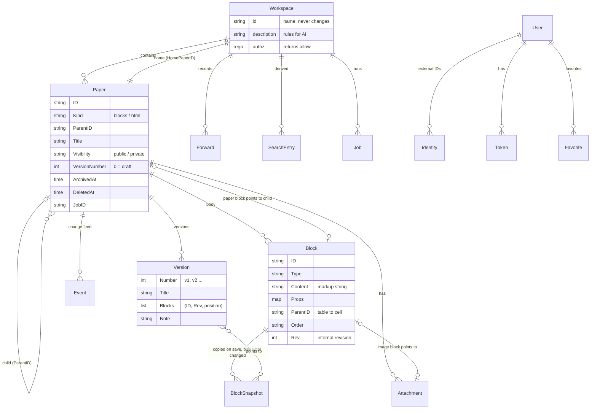
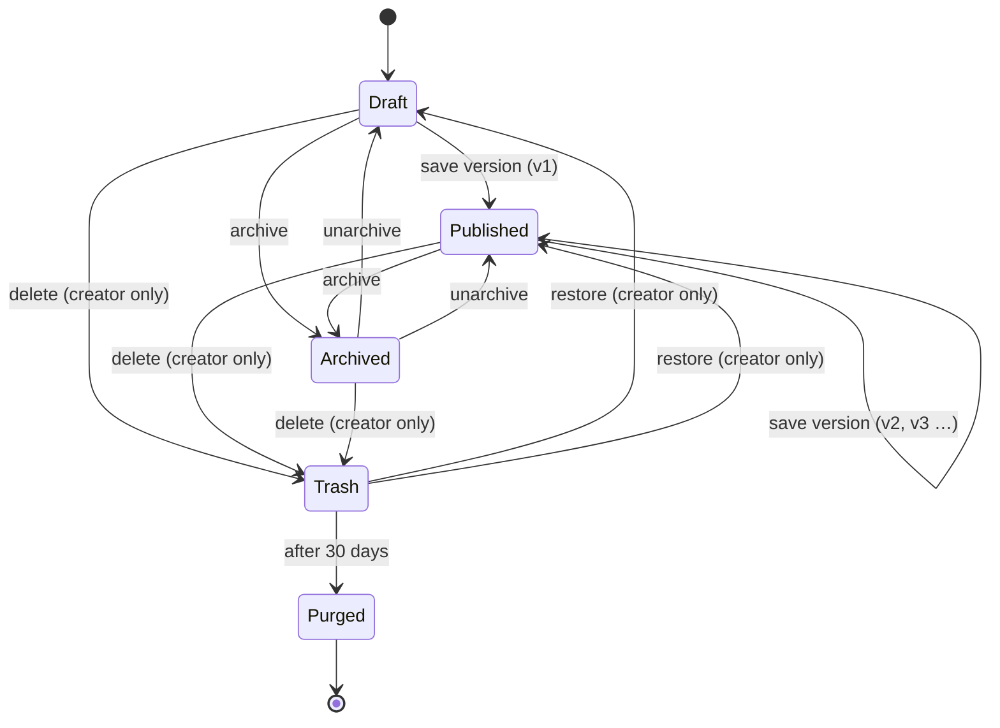
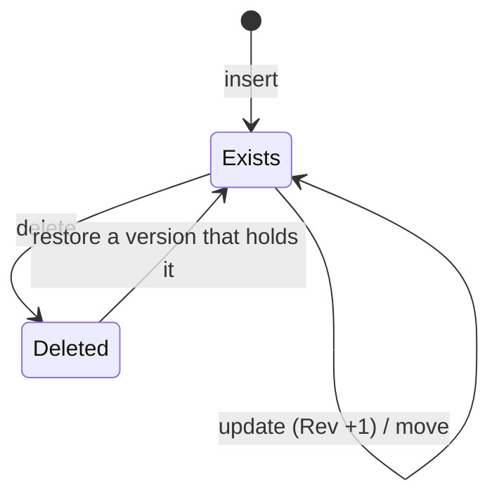
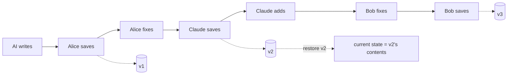

# papers model and concepts

Everything papers handles, defined one by one: what the words mean, what values things hold, the promises kept, and how things live and change. The aim is to know what is stored, and what changes when something happens, without reading the code.

Drafted 2026-11-21. The same day D10 and D11 (text formatting and rich editing) were added and workspaces were decided to be defined in configuration files (as in hecatoncheires). It details the design starting from the [codebase map](codebase.md). Also the same day most of D1–D18 were decided, versions were reduced to "copies saved on purpose" (D15), and the model was drawn (entities and relations, paper states, storage layout). The decisions on organizing papers (nesting, the home, versions, moves) are included. On 2026-11-22, work on whole subtrees and moves across workspaces were decided to run as [background jobs](#background-jobs-job) ([D19](#d19-operations-on-whole-subtrees-and-moves-across-workspaces-run-as-background-jobs-decided-2026-11-22)), and the model was implemented. On 2026-11-23, [HTML papers](#d20-html-papers-decided-2026-11-23) (D20) were added: a paper kind whose body is one HTML document written through the API.

> **This document is the source of truth for papers' model and concepts (decided 2026-11-22)**. On terms, entities and relations, values, invariants, access, storage layout, operations, conflict rules and versions, when another document ([design.md](design.md), [codebase.md](codebase.md)) or the code disagrees, this document wins.

## Terms

Screens, the API, the code and this document use the same words with the same meanings. The second column is the name in the code and the API.

| Term                   | Code name     | Meaning                                                                                                                                                                                           |
|------------------------|---------------|---------------------------------------------------------------------------------------------------------------------------------------------------------------------------------------------------|
| Workspace              | `Workspace`   | The container of papers and the basic unit of access; also what users switch between on screen. **Defined in configuration files, not stored as data**.                                           |
| Paper                  | `Paper`       | One document: a title and a list of blocks, written by people and AI together. Other papers can be embedded in its body as children.                                                              |
| Home                   | home          | The root paper; one per workspace. It cannot be deleted or moved.                                                                                                                                 |
| Paper block            | `paper` block | The block that places a child paper in its parent's body. It holds only the child's ID.                                                                                                           |
| Parent, child, subtree | `ParentID`    | A paper placed in a body by a paper block is a child; the paper whose body it is, the parent. A paper's subtree is its children, their children, and so on.                                       |
| HTML paper             | `Kind` `html` | A paper whose whole body is one HTML document written through the API (REST, MCP). People only view it, in a sandboxed frame where its scripts run; everything but the body works as for any paper ([D20](#d20-html-papers-decided-2026-11-23)). |
| Paper kind             | `PaperKind`   | How a paper's body is held: `blocks` (blocks people and AI edit) or `html` (an HTML paper). Set at creation, never changed.                                                                        |
| Block                  | `Block`       | The smallest unit of editing and of conflicts: a paragraph, a heading, a table cell, a diagram written by AI, and so on.                                                                          |
| Contents               | contents      | A block's type, text and properties. "The contents changed" means one of those three changed.                                                                                                     |
| Position               | position      | A block's parent and order key. Handled apart from the contents; changing a position is never a conflict.                                                                                         |
| Current state          | current       | **The latest state being edited**. Writes by people and AI show here at once. There is no autosave: whatever is written is the current state.                                                     |
| Version                | `Version`     | An immutable copy of the whole paper that a writer (person or AI) **saved on purpose**. The system never makes one. Counted per paper as v1, v2 … History is referred to and restored by version. |
| Status                 | status        | Draft (no version), canonical (has versions) or archived. Follows from the versions and the archive mark.                                                                                         |
| Operation              | `Op`          | One change a writer asks for: insert, update, delete, move, change the title, insert Markdown. Also moving a paper, changing its visibility, saving a version, restoring a version, archiving.    |
| Batch                  | batch         | The list of operations a writer sends in one request; all are applied or none. It is not recorded (what remains is the current state and versions).                                               |
| Base revision          | `base_rev`    | The block's internal update number (`Rev`) when the writer read it. Used only to judge conflicts; never shown on screen.                                                                          |
| Conflict               | `Conflict`    | Another writer changed the block's contents after it was read. The write is refused.                                                                                                              |
| Force                  | `force`       | Overwriting despite a conflict. The result becomes the current state (nothing else is recorded).                                                                                                  |
| Restore                | `restore`     | Setting a paper's current state back to a version's contents. The version is not rewritten. There is no per-block restore.                                                                        |
| Writer                 | `Actor`       | The record of who made a change: a person or an AI, and for whom.                                                                                                                                 |
| Principal              | `Principal`   | Who is making the current request: the user and the token in use. Used to decide access.                                                                                                          |
| Visibility             | `Visibility`  | public / private, per paper. A public paper can be read and written by everyone who may use the workspace; a private one only by the user who created it.                                         |
| Unfiled                | unfiled       | A public paper without a parent, other than the home. It is not in the tree and gains no children (only restoring a version can bring back children it had); it shows in the papers list. A paper created without a parent starts unfiled.                    |
| Favorite               | `Favorite`    | A public paper a user keeps in the sidebar's favorites; personal.                                                                                                                                 |
| Search entry           | `SearchEntry` | A plain-text copy of a title or a block, kept only for search (derived data).                                                                                                                     |
| Change feed            | `Event`       | How changes to an open paper reach screens, as the resulting state.                                                                                                                               |

## Overview



*Entities and relations. Boxes are entities with their main values. Papers and blocks are the core that people and AI write; workspaces live in configuration files rather than storage; search entries are derived (copies that can be rebuilt). Writers (`Actor`: person or AI, the user acted for, the display name) are values embedded in blocks and versions, never stored on their own. Nesting is a `paper` block in the parent's body pointing to the child, and the child keeping its parent in `ParentID` ([Tree](#tree-nested-papers)).*

Storage follows the same nesting (`workspaces/{ws}/papers/{p}/blocks/{b}`, `…/papers/{p}/versions/{n}`, `workspaces/{ws}/search/{…}`; the whole layout is in [Storage](#storage-layout)). Workspaces themselves are configuration and appear in storage only as an ID namespace. Users, tokens and sessions live outside workspaces.

## ID

papers issues its own IDs and never uses an external service's ID (a Google subject, say) directly. An ID never changes and is never reused after deletion.

| What                                                                   | Format                                                                                                                                      | Issued by                          | Example                    |
|------------------------------------------------------------------------|---------------------------------------------------------------------------------------------------------------------------------------------|------------------------------------|----------------------------|
| Workspace                                                              | A short name of lowercase letters, digits and hyphens (`^[a-z0-9]+(-[a-z0-9]+)*$`, up to 63 characters)                                     | Written in the configuration       | `security`                 |
| Everything else (papers, blocks, attachments, users, sessions, tokens) | A UUID v4 (122 random bits) in alphanumeric base62 (`0-9 A-Z a-z`), 22 characters, left-padded with `0`                                     | Server                             | `1csQdaLtbzOEz6NzfMfH6Z`   |
| Version                                                                | A sequence number per paper (1, 2, 3 …)                                                                                                     | Server (in the saving transaction) | `…/papers/{id}/versions/2` |
| Block revision (`Rev`)                                                 | An internal number per block, +1 whenever its contents change                                                                               | Server                             | never shown on screen      |
| Search entry                                                           | `{paper ID}_{block ID}`, or `{paper ID}_title` for the title                                                                                | Server (derived)                   |                            |
| Session and token secrets                                              | The 22-character ID above plus a separate random secret (only a hash of the secret is stored). A token is handed out as `pap_{ID}.{secret}` | Server                             |                            |

- **One format**: every ID is a shortened UUID v4. Whatever needs an order uses a creation time or a number (versions).
- **Why a shortened v4**: IDs appear again and again in URLs, API answers and text given to AI, so 36 characters shrink to 22. No symbols, so a double click selects the whole ID and it never clashes with separators. Case-sensitive. Random, so not guessable and leaking no time.
- **Checked on input**: 22 alphanumeric characters that decode to a UUID v4. Anything else is 404, the same as an ID that does not exist.
- **The server issues every ID**: if clients chose IDs, every entry point would have to guard against IDs of other papers or deleted blocks (mixing histories, overwriting a deleted block with something else), and writes from AI or the API cannot be trusted with that. No ID is chosen by a client.
- **Referring to a new block within the same batch**: an `insert` may carry a temporary name (`ref`, e.g. `"n1"`), and later ops refer to it as `after: "ref:n1"`. A ref is valid only within its batch and is not stored. The answer maps each ref to the issued ID.
- **Showing first on screen**: the UI shows a new block under a local temporary key and swaps in the real ID from the answer. Edits before the swap are held locally and sent once the ID is known. Live changes arrive with real IDs and are matched with the answers to one's own ops so nothing shows twice.
- **IDs and Firestore**: IDs are random, so the Firestore hotspot of monotonically increasing IDs never occurs.
- **URLs**: a paper's current state is `/ws/{workspace}/p/{paper ID}`, its latest version `…/latest`, version vN `…/v/{n}` ([Current state and versions](#current-state-and-versions)). Workspace IDs are readable names, so the first half of a URL reads well.

## Workspaces

The container of papers and the basic unit of access, about the size of a team or a department. **Workspaces are defined in configuration files; the UI and the API neither create nor change them** (as in hecatoncheires). Nothing spans workspaces except moving a paper (as copy and delete); there is no cross-workspace search.

### Defining one

```text
# One file per workspace in the directory given to --config
# workspaces/security.toml
[workspace]
id          = "security"            # never change: it is the storage namespace
name        = "Security Team"
description = """
Runbooks for on-call and incident retrospectives.
Write procedures as numbered lists and put commands in code blocks.
"""                                   # given to AI as this workspace's rules
emoji       = "🛡️"
language    = "en"                  # optional

[authz]                              # who may use this workspace (returns allow)
policy = ["policies/security.rego"]

[sandbox]                            # optional: what AI-authored HTML may do here
external_resources = false           # default true
```

- **id**: `^[a-z0-9]+(-[a-z0-9]+)*$`, up to 63 characters, unique across workspaces. **Must never change** (it becomes the storage path `workspaces/{id}/…`). To rename, change name.
- **name**: The display name; id when omitted.
- **description**: What the workspace collects and how to write in it. Shown to people as a description, and given to AI as "this workspace's rules" by MCP's `papers_guide` and with read and write results.
- **emoji / color**: A mark on screen; one or the other.
- **language**: The default language AI writes in (optional).
- **authz**: The rule for who may use this workspace: Rego returning `allow` (true / false) ([Access](#access)).
- **sandbox.external_resources**: Whether AI-authored HTML drawn in a sandboxed frame (HTML papers, `html` and `svg` blocks) may load anything from other hosts (scripts, styles, images, fonts, connections). Optional, true when absent. False keeps the HTML to what it embeds ([D20](#d20-html-papers-decided-2026-11-23)).


- **Everything an administrator would decide is written in configuration files**. They ship with deployments, so who can change them is decided by who can deploy. The UI and the API have no way to change global settings.
- Everything is validated at startup, and any invalid file stops the server from starting. Changes take effect on restart.
- Display groups of workspaces (how the sidebar groups them) are written in the global configuration file (`--global-config`). Groups only organize the display and have no effect on access.
- **Home**: at startup each configured workspace gets a home paper if it has none (exactly one however often the server starts). Which paper is the home is recorded as `HomePaperID` in the stored `workspaces/{id}` record. Its first title is name. `/ws/{id}` opens the home ([Tree](#tree-nested-papers)).
- The description is "the rules for AI" (changed by deploying); the home paper's body is "the workspace's summary and entrance, read by people and AI" (anyone can write it).
- Removing a workspace from the configuration does not delete its data, home included ([D13](#d13-data-of-a-workspace-removed-from-the-configuration-stays-but-is-hidden-decided-a)).

> So the UI and the API have no way to create a workspace or change its name or who may use it, and no permission setting for creating one is needed. Deleting or archiving a workspace means "remove it from the configuration" (outside D4).

## Papers

A title and an ordered list of blocks. People and AI write the same papers with the same operations. What is written becomes the **current state** (the latest, being edited) at once. A [version](#current-state-and-versions) exists only when someone (a person or AI) explicitly saves one, and history is the list of those versions.

- **ID / WorkspaceID**: Never change. A "move" across workspaces is a copy under new IDs plus deleting the original ([Tree](#tree-nested-papers)).
- **Kind**: `blocks` or `html` ([HTML paper](#d20-html-papers-decided-2026-11-23)). Set when the paper is created and never changed. A record written before kinds existed has none and is `blocks`.
- **ParentID**: The parent paper. Always matches the paper block for this paper in the parent's body (written in the same transaction). Empty for the home, for unfiled papers and for private papers. No list of ancestors is kept ([Tree](#tree-nested-papers)).
- **Title**: One line, up to 256 bytes. May be empty ("Untitled" on screen). Included in versions, but has no revision of its own: concurrent changes are last-write-wins ([D1](#d1-titles-are-under-version-history-but-have-no-revision-of-their-own-decided)).
- **Visibility**: `public` (default) or `private`; meaning in [Access](#access). Only the creator changes it. Private papers are not in the tree; they show in the [papers list](#papers-list), to their creator only.
- **VersionNumber**: The number of the latest version. 0 means draft, 1 or more means published.
- **ArchivedAt**: When it was archived. Non-empty means archived (regardless of versions). Lists and search leave archived papers out by default.
- **DeletedAt / DeletedWith**: When it went to the trash, and the ID of the paper whose subtree deletion took it there ([D4](#d4-deleting-a-paper-puts-it-in-the-trash-decided)). Purged after 30 days.
- **JobID**: The [background job](#background-jobs-job) working on this paper. While set, only that job may write it (other writes are refused as "busy"). During a move the paper is also left out of search (so a half-made copy is never shown; the original is hidden for that time too).
- **CreatedBy**: The writer who created it. Only this user (for a paper made by AI, the user it acted for) may read and write a private paper.
- **UpdatedAt / UpdatedBy**: The **approximate** last update. To keep writes to the paper record low, it is updated only on a title change or a write at least one minute after the previous update, so it may lag by up to a minute ([D6](#d6-update-times-stay-as-they-are-decided-b)).

### Paper states



Anyone who can use the paper may archive and unarchive it. Only the creator deletes, restores and purges (with the subtree), and restoring returns the paper to the state it was in. No transition applies to the home. Visibility (public / private) and the position in the tree are separate from this state.

*The state follows from three values: `VersionNumber` (0 means draft), `ArchivedAt` and `DeletedAt`. A published paper never becomes a draft again. Archiving only leaves a paper out of search, lists and AI's guidance; it still opens by URL ([D18](#d18-only-the-creator-deletes-others-archive-decided-inviting-to-private-papers-later)).*

### Why the paper record is rarely written

Firestore sustains about one write per second to a single document. If every write touched the paper record, it would become the bottleneck. So contents live on blocks, and the paper record holds only the title, parent, visibility, state and approximate update time. Parent, visibility and state change rarely.

## Tree (nested papers)

There is no container concept (folders). A child paper is placed as a **paper block** in its parent's body (as in Notion). The parent's body itself becomes the place that introduces and summarizes its children. The tree is the structure people use to know where things are; depth is not limited.

### Shape

- Each workspace has one **home** paper. The home cannot be deleted, moved or made private.
- Where a paper is follows from two values, `Visibility` and `ParentID`; there is no separate value for it. Every paper is in exactly one of these places:

| Place       | Visibility | ParentID                        | Children | Shown in                                           |
|-------------|------------|---------------------------------|----------|----------------------------------------------------|
| Home        | public     | empty (the workspace's home)    | yes      | The root of the tree in the sidebar                |
| Filed       | public     | the parent's ID                 | yes      | The tree (a paper block in the parent's body)      |
| **Unfiled** | public     | empty (any paper but the home)  | **no** (only those a restored version brings back) | The [papers list](#papers-list); not in the tree   |
| Private     | private    | empty                           | no       | The papers list, to its creator only               |

- **Every filed paper sits in exactly one parent's body as exactly one paper block**. The top level is in the home's body. A parent is the home or a filed paper; unfiled and private papers are never parents, so the tree has one root, the home.
- **Unfiled papers are public but not in the tree**. A paper created without a parent (the UI's "New", REST and MCP without `parent`) is unfiled. "Move…" files it under a parent; "Move to unfiled" (`unfiled` on a move) takes a filed paper out of the tree again, only when it has no children (papers in the trash do not count). Restoring a version of an unfiled paper brings back the children that version has and that are still in the trash, so an unfiled paper can have children that way; it still takes no new ones (no insert, move or create under it), and it is filed or emptied of children before it can be unfiled again.
- **HTML papers have no children**: their body is one document, so nothing can be placed under them. They can be filed, unfiled or private like any paper.
- **Private papers are not in the tree**. They have no parent or children. Making a private paper public places it under the parent given, or leaves it unfiled when none is given. Only a public paper without children can be made private.
- The order of children is the order of the paper blocks in the parent's body; it is not stored separately.
- Depth is not limited. As a safety valve in the implementation, walking up parents stops at 100 levels.

### What each operation does

| Operation                     | What happens                                                                                                                                                                                                                                                                                                                                                                                                                                                                                                                                                                      |
|-------------------------------|-----------------------------------------------------------------------------------------------------------------------------------------------------------------------------------------------------------------------------------------------------------------------------------------------------------------------------------------------------------------------------------------------------------------------------------------------------------------------------------------------------------------------------------------------------------------------------------|
| Create a child                | Insert a `paper` block into the parent's body, and create the child paper in the same batch. The parent must be the home or a filed paper; inserting a `paper` block into an unfiled or private paper is refused.                                                                                                                                                                                                                                                                                                                                                                 |
| Create without a parent       | Write the new paper only: public with an empty `ParentID` (unfiled), or private. No body is written.                                                                                                                                                                                                                                                                                                                                                                                                                                                                              |
| Delete a paper block          | Done by a [background job](#background-jobs-job) (`drop`). If everything below belongs to the person deleting, the child goes **to the trash with its subtree** and the block is removed. If others' papers are included, the block stays and the child is archived with its subtree ([D18](#d18-only-the-creator-deletes-others-archive-decided-inviting-to-private-papers-later)). Going to the trash sets `DeletedAt` and `DeletedWith` on the subtree. The UI shows the count and asks before deleting. When the parent is restored to a version and the block comes back, the subtree with the same `DeletedWith` comes back too (when it is the creator restoring). |
| Move (same workspace)         | Remove the paper block from the old parent's body (nothing to remove when the paper was unfiled), add a new paper block to the new parent's body, and rewrite the child's `ParentID`: at most these three writes in one transaction. The new parent must be the home or a filed paper. **Nothing below is written** (descendants only point to their parents, so they follow). Moves are last-write-wins and are never conflicts. The move itself is not recorded. The change to the parents' bodies shows in a version the next time that parent is saved.                                                                                                                           |
| Move to unfiled               | Only for a filed paper without children (papers in the trash do not count). Remove the paper block from the parent's body and clear `ParentID`, in one transaction.                                                                                                                                                                                                                                                                                                                                                                                                              |
| Move (across workspaces)      | Done by a [background job](#background-jobs-job) (`move`). The subtree is copied under new IDs, the original subtree goes to the trash, and a forward from the old ID to the new place is recorded. The current state and the latest version (which becomes the copy's v1) are copied; older versions are not.                                                                                                                                                                                                                                                                                    |
| Restore a parent to a version | Paper blocks of children that moved elsewhere are not restored (once moved, they are no longer the old parent's). The result lists the "children not restored". A child in the trash comes back if the person restoring is its creator (otherwise it does not, and the result lists it), also when the parent is unfiled now. A child purged from the trash is gone for good: the version holds only the child's ID, so it is not brought back (listed as missing). Reading a version (`GET …/versions/{n}`) says, for each child, whether restoring keeps it, brings it back from the trash, or does not restore it (moved, in someone else's trash, missing), so the UI warns before restoring. The child itself is restored within the batch; the subtree that went to the trash with it is restored by a [background job](#background-jobs-job) (`restore`).                                                                                                                                           |

### Reading

- A paper keeps only its parent, not a list of ancestors, so a move of thousands or tens of thousands of papers still writes only three records.
- Breadcrumbs and paths (`security / Runbooks / DB failover`) and cycle checks walk up parents. The server keeps a "paper → parent" map in memory and updates it from the change feed; inside a transaction it reads again to confirm.
- The list of children comes from the parent's body. Their titles and states are read in one batch read.
- "Search under here" walks up the parents of each hit to filter. "Archive or export a subtree" is a [background job](#background-jobs-job) that descends one level at a time through the children index.
- AI may name a parent by path (if several papers share a title, the candidates are returned). URLs stay as IDs.

### Sidebar

The whole tree is not shown. The sidebar shows the home, the user's favorites (`Favorite`: user, workspace, paper, order key) and what is under them (only the levels opened are read), a few recently opened papers, and the number of the user's own unfiled and private papers (counted up to 100; 100 means "100 or more"). Private papers are listed through the papers list, not the sidebar. The home and private papers cannot be favorites.

### Papers list

The papers list shows papers outside the tree and lets people find their own. It filters by place (unfiled — which includes the user's private papers —, filed, or all), creator (the user or everyone), visibility (all, public, private) and whether archived papers are included, and sorts by update or creation time, newest first. The default is "my unfiled papers". It never shows the home, papers in the trash, papers a move is working on, or papers the caller may not see. For each paper it shows the parent's title only (not the whole path), read in one batch. It is read a page at a time (at most 100 papers).

## Background jobs (Job)

Operations on a whole subtree and moves across workspaces do not always fit in one transaction: one Firestore write is at most 10 MiB and a transaction at most 270 seconds. The size of a subtree is not limited, so a large tree will exceed these somewhere. These run as **background jobs**, split into a series of small transactions ([D19](#d19-operations-on-whole-subtrees-and-moves-across-workspaces-run-as-background-jobs-decided-2026-11-22)). Moves within a workspace and visibility changes write three records or fewer, so they are not jobs.

- **ID / WorkspaceID**: Issued by the server. Stored in the workspace where it started (for a move, the source workspace).
- **Kind**: `trash` (to the trash), `drop` (a paper block was removed from a body), `restore` (back from the trash), `archive` / `unarchive` (with the subtree), `move` (move across workspaces).
- **PaperID / BlockID**: The root paper; for `drop`, also the paper block removed from the parent's body.
- **Target**: Where a `move` goes (workspace, parent, position).
- **CreatedBy**: The writer who started it. The job runs with this writer's rights, and what it writes is written as this writer.
- **State**: `queued` → `running` → `done` or `failed`.
- **Phase / Done / Total**: The current phase, and how many items are done out of how many (progress).
- **Result / Error**: The result (whether it went to the trash or was archived, papers not restored, the copy's ID and the forward) and, for `failed`, why.
- **LeaseUntil**: Until when the instance running it holds it. After that another instance takes over.
- **ExpireAt**: Removed 7 days after it finishes.

Each paper in scope gets a **JobItem** under the job (paper, parent, depth, whether its children were collected, whether it is done, and for a move the copy's ID and where it was copied). The list is not kept on the job record itself so that it stays under the document size limit (1 MiB).

### How a job runs

1.  The request checks only what it can check right away (the paper can be used, the caller is the creator, it is not the home, the target can be used), creates the job and **answers at once**. The same instance then runs the job. The result shows through ordinary reads and the change feed (there is no API to read a job's state).
2.  Each step is one transaction handling up to 200 items, and progress is written in the same transaction. Every step gives the same result when repeated (idempotent). Copy IDs are derived from the job and the source ID, so rewriting a copy never duplicates it.
3.  If an instance stops, another instance picks up the job once its lease has expired and continues.
4.  Transient failures are retried with backoff. Failures by rule (the target went to the trash, say) mark the job `failed`, and when the phase allows it the changes so far are rolled back. Failures notify no one and are only logged on the server (they happen only when something changed after the answer).

### Phases by kind

| Kind                    | Phases                                                                                                                                                                                                                                                                                                                                                                                                                                                                          | Others' papers and failures                                                                                                                                                |
|-------------------------|---------------------------------------------------------------------------------------------------------------------------------------------------------------------------------------------------------------------------------------------------------------------------------------------------------------------------------------------------------------------------------------------------------------------------------------------------------------------------------|----------------------------------------------------------------------------------------------------------------------------------------------------------------------------|
| `trash`                 | **Collect**: gather the subtree one level at a time through the children index and check that everything belongs to the person who started it. → **Apply**: first trash the root and remove its paper block from the parent's body (one transaction), then set `DeletedAt` and `DeletedWith` on the subtree.                                                                                                                                                                    | If collecting finds others' papers, nothing is deleted; the root is archived with its subtree instead ([D18](#d18-only-the-creator-deletes-others-archive-decided-inviting-to-private-papers-later); no one but its creator ever deletes a paper). |
| `drop`                  | The same as `trash` (it remembers the removed paper block).                                                                                                                                                                                                                                                                                                                                                                                                                     | If others' papers are there, the block stays and the subtree is archived.                                                                                                  |
| `restore`               | Restore the root and place it under its nearest ancestor that is not in the trash (an unfiled or private root stays where it was), then restore the starter's papers below with the same `DeletedWith`. When restoring a version brings a child back, the child is restored within the batch and only its subtree by this job.                                                                                                                                                                                                  | —                                                                                                                                                                          |
| `archive` / `unarchive` | Collect the subtree and set or clear the mark.                                                                                                                                                                                                                                                                                                                                                                                                                                  | —                                                                                                                                                                          |
| `move`                  | **Collect**: gather the subtree and set `JobID` on every original (stopping writes). → **Copy**: copy the current state, the latest version (the copy's v1) and attachments under new IDs. Copies also carry `JobID` and are not attached to the tree. → **Attach**: clear the mark on the copies and place the copy's root in the target parent's body. From here on nothing is rolled back. → **Retire**: trash the original subtree, record the forward and clear the marks. | Before attaching, the copies are deleted and the marks on the originals cleared (the originals stay as they were).                                                         |

### What is visible

- Jobs themselves are shown to no one. The UI and AI learn the result from paper states (trashed, archived, busy while moving) and the change feed.
- When a move finishes, the original paper carries the forward. Opening the original (even in the trash) leads to the new place.
- Intermediate states may be visible (only part of a subtree in the trash, say). Search and lists judge by each paper's mark, so they settle once the job finishes. A move alone makes the originals read-only and hides the copies, so no write is lost midway and no half-made copy is seen.

## Blocks

The smallest unit of editing, conflicts and search entries. A block has **contents** (type, text, props) and a **position** (parent, order key), and the two are handled separately.

- **ID**: A 22-character ID issued by the server ([IDs](#id)); clients cannot choose it. Once used, an ID belongs to the same block even after deletion (restoring brings it back).
- **Type**: One of the types in the table below.
- **Content**: The text; its meaning depends on the type (table below). Up to 256 KiB.
- **Props**: Per-type properties. Properties unrelated to the type are removed before saving (changing the type leaves no old properties behind).
- **ParentID**: The parent block. Only table cells have a parent (the table); everything else is empty (directly under the paper). The tree is one level deep.
- **Order**: An order key among siblings (fractional index). A new key always fits between two keys, so inserting or moving never rewrites other blocks. Equal keys fall back to ID order.
- **Rev**: An internal revision, +1 whenever the contents (type, text, props) change (not when the position changes). Writers send it as the "base revision". Never shown on screen.
- **CreatedBy / UpdatedBy**: The first writer and the last writer to change it (with times).

### Block types

| Type                                        | Meaning of the text                                                                                             | Props                                                                          | People edit | Search entry                                         |
|---------------------------------------------|-----------------------------------------------------------------------------------------------------------------|--------------------------------------------------------------------------------|-------------|------------------------------------------------------|
| `paragraph`                                 | Inline Markdown (bold, italic, strikethrough, code, links) and colour spans `[text]{.colour}` ([D10](#d10-inline-styling-in-blocks-is-a-markup-string-decided-a)) | none                                                                           | ✓           | text                                                 |
| `heading`                                   | Inline Markdown                                                                                                 | `level` 1–3                                                                    | ✓           | text                                                 |
| `quote`                                     | Inline Markdown                                                                                                 | none                                                                           | ✓           | text                                                 |
| `bulleted_list_item` / `numbered_list_item` | Inline Markdown                                                                                                 | `indent` 0–6 (nesting is indentation, not a tree)                              | ✓           | text                                                 |
| `todo`                                      | Inline Markdown                                                                                                 | `indent`, `checked`                                                            | ✓           | text                                                 |
| `callout`                                   | Inline Markdown                                                                                                 | `icon` (one emoji)                                                             | ✓           | text                                                 |
| `code`                                      | Source code (verbatim)                                                                                          | `language`                                                                     | ✓           | text                                                 |
| `divider`                                   | empty                                                                                                           | none                                                                           | ✓           | none                                                 |
| `paper`                                     | empty                                                                                                           | `paper_id` (the child paper; never changes). Only at the top level of a body   | ✓           | none (the child's title is the child's search entry) |
| `image`                                     | caption                                                                                                         | `attachment_id` (an attachment of the same paper) or `url` (an external image) | ✓           | caption                                              |
| `table`                                     | empty                                                                                                           | `rows`, `cols` (each a list of (ID, order key)), `header_row`                  | ✓           | none (on the cells)                                  |
| `table_cell`                                | Inline Markdown                                                                                                 | `row_id`, `col_id` (row and column IDs of the parent table)                    | ✓           | text                                                 |
| `mermaid`                                   | Mermaid source                                                                                                  | `height`                                                                       | AI only     | source                                               |
| `svg`                                       | A complete `<svg>` element                                                                                      | `height`, `fields`                                                             | AI only (people edit `fields`) | text nodes, then the `fields` values |
| `html`                                      | Self-contained HTML                                                                                             | `height`, `fields`                                                             | AI only (people edit `fields`) | text nodes, then the `fields` values |
| `html_page`                                 | The text nodes of the HTML paper's document (up to 8 KiB), for search                                           | `attachment_id` (required: the paper's `text/html` attachment)                 | no one (the server writes it; `set_html` changes it) | the text |

**html_page** is the whole body of an [HTML paper](#d20-html-papers-decided-2026-11-23) and exists only there: the server creates it with the paper and changes it only through `set_html` and restoring a version. Its ID never changes for the life of the paper, and each document it has pointed to stays as an immutable attachment, so a later comment can name the block and the document it was written on.

"AI only" is a limit of the UI, not of writing. The API and MCP accept them even with a person's token, but the web UI offers no way to edit them and only draws them in a sandboxed iframe.

**Fields of html and svg blocks**: AI marks the elements whose value people may change with `data-field="name"` and keeps the values in `props.fields` (name → string). Names match `^[a-z][a-z0-9_]{0,31}$`, a block has at most 32 fields, and a value is at most 200 bytes of UTF-8 without line breaks. People change only these values, in place, through an ordinary `update` with the base revision; the HTML or SVG itself (the text) is never changed by people. The sandboxed frame hands the page only the name and the new value, and the page and the server both validate them. `fields` is part of the contents (it raises `Rev` when it changes) and is dropped from every other block type.

### Life of a block



*A deleted block's contents remain in any version that contains it, and restoring the paper to that version brings it back under the same ID. A block created and deleted before any save leaves nothing.*

## Current state and versions

A paper has only two things: the **current state** (the latest, being edited; writes from people and AI show at once) and **versions** (immutable copies of the whole paper, saved explicitly by a person or AI). There is no autosave and no fine-grained edit history. History is viewed and restored by version, per paper (never per block).



*The current state keeps changing with every write. A version exists only when someone (a person or AI) saves; the system never makes one on its own. Fine-grained changes between versions are not kept.*

### What a version holds

- **PaperID + Number**: Per paper, from 1 without gaps (v1, v2 …). Decided together with `Paper.VersionNumber` in the saving transaction.
- **Title**: The title at that moment.
- **Blocks**: The list of (block ID, `Rev`, parent, position) for every block at that moment. Contents point to a `BlockSnapshot` (an immutable copy per block ID + `Rev`). On save, a snapshot is made only for blocks whose `Rev` changed since the previous version; unchanged blocks point to the earlier snapshot. A paper block carries the child's ID but not the child's contents (each child has its own versions).
- **Note**: What changed in this version (optional). AI writes one through `save_version`; people's saves leave it empty for now. It is kept so that people can be given a way to write one later.
- **CreatedBy / CreatedAt**: The writer who saved (person or AI, and for AI whom it acted for) and when.


- **Who saves**: any writer who can use the paper (people and AI): "Save" in the UI, `save_version` in the API and MCP. **The system never saves on its own** (there is no autosave). The version list shows who saved ("v4 · Claude (for Alice)").
- **The first version (v1) turns a draft into a published paper**. A published paper never becomes a draft again; archive it when it is no longer needed.
- **No undo**: versions are never rewritten or deleted (only purged together with the paper). If one is wrong, restore an earlier version and save that as a new version.
- **Nothing changed since the previous version means no save** (the answer is "nothing happened").

### What you can do

| To                | How                                                                                                                                                                                                                                                                                                                                              |
|-------------------|--------------------------------------------------------------------------------------------------------------------------------------------------------------------------------------------------------------------------------------------------------------------------------------------------------------------------------------------------|
| See the history   | The paper's versions, newest first: who saved when, and the note                                                                                                                                                                                                                                                                                 |
| See a version     | Read one version and batch-read the snapshots it points to (nothing to reconstruct)                                                                                                                                                                                                                                                              |
| Diff              | Match two versions, or a version and the current state, by block ID and `Rev`, and read and compare only what differs                                                                                                                                                                                                                            |
| Restore a version | Make the current state match that version (deleted blocks come back under the same IDs; blocks made since are removed). **Unsaved changes** in the current state are lost, so the UI asks "save first?" before restoring. Children that moved elsewhere are not restored; children in the trash come back only for their creator ([Tree](#tree-nested-papers)) |

### URLs and what they show

| URL                      | Shows                                                                                 | Edit |
|--------------------------|---------------------------------------------------------------------------------------|------|
| `/ws/{ws}/p/{id}`        | The current state (the latest, updated live). With versions, shows "changed since v3" | yes  |
| `/ws/{ws}/p/{id}/latest` | The latest version; follows new versions. For a draft, "no versions yet"              | no   |
| `/ws/{ws}/p/{id}/v/{n}`  | That version; its contents never change                                               | no   |
| `/ws/{ws}`               | The home's current state                                                              | yes  |
| `/`                      | The home of the last workspace opened (the list the first time)                       | —    |

- Links in bodies, paper blocks, the sidebar and search results go to the plain URL. Search looks in the current state.
- AI reads the current state by default (`at` may name `latest` or a number). When AI cites a paper as the basis of an answer, it cites `/v/{n}`.
- Lists and search show drafts and published papers and leave archived ones out by default.

## Operations

A writer sends a list of operations (Ops) in one request (a batch). Either all apply or none does. The applied result becomes the current state. The batch itself is not recorded.

| Op                      | Required                                                                                       | Base revision                          | Result                                                                                                                     | When nothing happens                       |
|-------------------------|------------------------------------------------------------------------------------------------|----------------------------------------|----------------------------------------------------------------------------------------------------------------------------|--------------------------------------------|
| `insert`                | Type (position by `after`; a temporary name `ref` is optional). For `paper`, the child's title, and `paper_kind` `html` with its `html` for an HTML paper | not needed                             | A block is added (for a table also its cells, for `paper` also the child paper)                                            | —                                          |
| `update`                | Block                                                                                          | **required**                           | Contents updated (`Rev` +1; cells added or removed when the table's shape changes)                                         | Contents unchanged                         |
| `delete`                | Block                                                                                          | **required**                           | Deleted (for a table also its cells; for `paper` the child goes to the trash with its subtree by a [background job](#background-jobs-job)) | Someone else already deleted it            |
| `move`                  | Block (position by `after`)                                                                    | not needed                             | Position changed                                                                                                           | Position unchanged, or already deleted     |
| `set_title`             | Title                                                                                          | none (last-write-wins, [D1](#d1-titles-are-under-version-history-but-have-no-revision-of-their-own-decided)) | Title changed                                                                                                              | Same title                                 |
| `insert_markdown`       | Markdown                                                                                       | not needed                             | A series of blocks is added                                                                                                | —                                          |
| `set_html`              | The HTML (an HTML paper only; at most one per batch)                                           | **required** (the `html_page` block's) | The document is replaced: a new attachment, and the `html_page` block points to it (`Rev` +1)                              | Same document                              |
| `move_paper`            | New parent (ID or path) and position, or `unfiled` (without a parent or a workspace)          | not needed                             | At most three records rewritten: old parent (none when the paper was unfiled), new parent (none for `unfiled`), the paper itself | Same position under the same parent, or already unfiled |
| `set_visibility`        | public / private (for public, optionally a parent and position; without a parent the paper becomes unfiled) | not needed                | The paper and its parent (if any) rewritten                                                                                | Same visibility                            |
| `save_version`          | Note (optional)                                                                                | not needed                             | A version is made                                                                                                          | Nothing changed since the previous version |
| `restore_version`       | The version number                                                                             | not needed (per paper)                 | Inserts, updates and deletes that make the current state match that version                                                | Same as the current state                  |
| `archive` / `unarchive` | Whether to include the subtree                                                                 | not needed                             | The archive mark (with the subtree, by a [background job](#background-jobs-job))                                                           | Already in that state                      |

### Batch rules

- The answer returns the result and the mapping from each `insert`'s temporary name to the issued ID.
- One batch changes at most 240 blocks and writes at most 3 MiB of text in total; beyond that the writer splits it.
- Moves and visibility changes within a workspace are written in one transaction even when they touch several papers. Operations on a whole subtree and moves across workspaces become [background jobs](#background-jobs-job), which start when the batch is answered.
- Batches have no message (explanations go in a version's note).

The UI sends each time the person leaves a block, but that only rewrites the current state; it adds no version.

## Base revisions and conflicts

There are no locks. A writer states which state it wrote from (that block's `Rev` = the base revision), and if another writer changed the contents since, the write stops once so nothing is lost unnoticed.

### The rule

When an op rewrites block *b* from base revision *r*, let *cur* be *b*'s state **before this batch started**.

| Situation                         | Result                                                                                                                       |
|-----------------------------------|------------------------------------------------------------------------------------------------------------------------------|
| No *r*, or *r* \> *cur.Rev*       | Invalid request (400)                                                                                                        |
| *r* = *cur.Rev*                   | Applied as is                                                                                                                |
| *r* \< *cur.Rev*                  | **Conflict**; with force, overwrite. `Rev` rises only when contents change, so a block that was only moved is not a conflict |
| *b* was deleted by another writer | An update is a **conflict** (even with force; the writer adds it again as a new block). A delete or move does nothing        |
| *b* was created in this batch     | Not checked                                                                                                                  |

- If a batch has even one conflict, nothing is written and all of them are returned (409, each with *cur*), so the writer can fix the whole batch at once.
- Comparison is with the state before the batch started, so touching the same block twice in one batch never conflicts with one's own first touch.
- The UI sends **the `Rev` from when editing started**. Sending the latest received just before saving would miss others' changes that arrived while editing.
- Contents overwritten by force are gone unless a version holds them (there is no fine-grained history). Before forcing, the UI shows the contents that will be overwritten.

### What never conflicts (on purpose)

- **Position**: reordering is last-write-wins. Order may swap, but no contents are lost.
- **Title**: last-write-wins. The losing change also remains in history ([D1](#d1-titles-are-under-version-history-but-have-no-revision-of-their-own-decided)).
- **Cells removed with a row or column**: base revisions are not checked. If someone is editing them, the person removing is told ([D3](#d3-deleting-rows-or-columns-does-not-check-the-cells-base-revisions-people-editing-them-are-told-decided)).
- **Visibility**: only the creator changes it, so there is no concurrent change. Last-write-wins.

## Writers and principals

Two similar words, kept apart. The **principal** is "who is making this request"; the **writer** (actor) is "the record that this one wrote it". Access is decided by the principal; when a principal writes, a writer is recorded.

|          | Principal                                                                               | Writer (Actor)                                                                           |
|----------|-----------------------------------------------------------------------------------------|------------------------------------------------------------------------------------------|
| In short | Who is making the request                                                               | The record of who wrote                                                                  |
| When     | Made per request; not stored                                                            | Made on every write and kept on blocks (creator, last writer) and versions (who saved)   |
| Holds    | User, the token used                                                                    | Person or AI, the user acted for, the display name at the time, the AI's name, the token |
| Used for | Access decisions (workspace rule, whether the creator of a private paper, token limits) | Showing "who wrote this", and knowing whose change was overwritten                       |
| Example  | Alice, coming with the token "Claude"                                                   | "Claude (for Alice)"                                                                     |

### People and AI

| Way in                                | Writer kind | Shown as                                      |
|---------------------------------------|-------------|-----------------------------------------------|
| Web UI (session)                      | person      | User name                                     |
| Web UI (anonymous mode)               | person      | "Anonymous 7fQa" (a guest of one browser)     |
| AI token (REST / MCP)                 | AI          | "Claude (for Alice)"                          |
| MCP with a session (development mode) | AI          | "MCP client (for …)"                          |
| Personal token (scripts)              | **person**  | User name (with "via API", [D7](#d7-writes-with-a-personal-token-stay-a-persons-marked-via-api-decided-b)) |

- AI always acts for someone. It borrows that person's access, narrowed by the token. There is no user that is AI alone.
- Users have IDs issued by papers and are tied to external IDs such as Google's through `Identity`. One person may sign in with several external IDs.
- **Anonymous users** exist only in anonymous mode (`--anonymous`, which excludes Google sign-in and `--no-authn`). A browser that comes without a valid session cookie gets a new user with `Anonymous` set, the email `{userID}@anonymous.invalid`, the name `Anonymous {last 4 characters of the ID}` and a session; it has no `Identity`, so its session is the only way back to it. When the session expires (`--session-ttl`) or the cookie is lost, that browser becomes a new anonymous user; the old user's private papers stay but nobody can see them. Otherwise an anonymous user is an ordinary user: it creates public and private papers, is their creator, and may issue tokens.

## Access

**There are no roles**. Only two things decide: whether one may use the workspace (the configured rule) and whether the paper is public or private. There is no viewer / editor / owner distinction and no per-paper assignment.

### How it is decided

1.  **May one use the workspace**: whether the Rego in the workspace configuration's `[authz]` returns `allow` (as in hecatoncheires). The input is the workspace and the user (ID, email, domain, and whether the user is anonymous). An anonymous user's domain is `anonymous.invalid`, so rules written with real domains keep them out; `allow if input.user.anonymous` lets them in. There are no user groups for now ([D14](#d14-no-groups-for-now-decided)), so rules are written with emails or domains. A workspace without a rule: [D12](#d12-a-workspace-without-a-rule-is-open-to-everyone-signed-in-decided-a).
2.  **May one use the paper**:
    - public → anyone who may use the workspace may read and write it (the home included)
    - private → only when one may use the workspace and is the creator
3.  **Narrowed by the token**: a read-only token cannot write, and nothing outside the allowed workspaces can be used. A token never extends what its user can do.

Decisions are cached briefly per instance (60 seconds, as in hecatoncheires), and anything that cannot be decided is refused.

### Conditions per operation

| Operation                                                                          | Condition                                                                                                                   |
|------------------------------------------------------------------------------------|-----------------------------------------------------------------------------------------------------------------------------|
| Read a paper, see its history, receive changes, find it in search, see it in lists | May use the paper (public: may use the workspace; private: the creator)                                                     |
| Create a paper                                                                     | May use the workspace (with a token that can write)                                                                         |
| Write blocks, change the title                                                     | May use the paper (with a token that can write)                                                                             |
| Create a child, move                                                               | May use every paper involved (old parent, new parent, the paper moved); across workspaces, may also use the target          |
| Save a version                                                                     | May use the paper (with a token that can write; AI too)                                                                     |
| Change visibility                                                                  | The creator only                                                                                                            |
| Delete a paper (to the trash with its subtree, restore, purge)                     | The creator only, and if it has a subtree everything below is theirs too ([D18](#d18-only-the-creator-deletes-others-archive-decided-inviting-to-private-papers-later)). The home cannot be deleted |
| Archive, unarchive                                                                 | Anyone who may use the paper. The home cannot be archived                                                                   |
| Decide workspaces and who may use them                                             | Whoever can change the configuration files (deploy rights; not possible from the UI)                                        |

### No system administrators

No one inside papers can do anything beyond the rules and visibility. Everything an administrator would decide goes into configuration files, which ship with deployments.

- Users are stopped at the sign-in (their Google account) or by the rules. The papers UI has no user management.
- A private paper whose creator is gone can be opened by no one ([D18](#d18-only-the-creator-deletes-others-archive-decided-inviting-to-private-papers-later)).

Callers who may not use something get "does not exist" (404), so no paper or workspace leaks its existence. Only when one may read but not write (a read-only token) is it 403.

## Storage layout

Where Firestore documents live. The shape mirrors the model's "has" relations. The paper tree (parent and child) is not part of paths but held in the `ParentID` value (so moves never change paths).

```text
workspaces/{ws}                         HomePaperID (workspaces are configuration; only a record here)
├── papers/{paper}                      Paper (title, parent, visibility, state)
│   ├── blocks/{block}                  Block current state and Rev (the only thing read)
│   │   └── snapshots/{rev}             snapshots versions point to (made on save; immutable)
│   ├── versions/{n}                    versions (saved explicitly; immutable)
│   ├── events/{id}                     change events (for fan-out only; short-lived)
│   └── attachments/{id}                attachment metadata: images, and HTML papers' documents (bytes in AttachmentStore)
├── search/{paper}_{block | title}      search entries (derived; plain text)
├── forwards/{old paper}                where a paper moved across workspaces went
└── jobs/{job}                          background jobs (removed 7 days after finishing)
    └── items/{paper}                   progress per paper in scope
users/{user}                            User
├── identities/{provider}_{subject}     ties to external IDs
├── favorites/{ws}_{paper}              favorites (order key)
└── recent/{ws}                         recently opened paper (one per workspace)
tokens/{token}                          API tokens (secret hash, limits)
sessions/{session}                      sign-in sessions (secret hash)
```

*Grey is derived or short-lived. Only attachment bytes live outside Firestore, in the AttachmentStore (Cloud Storage in production, memory or a file system in development). Versions and snapshots are only created, never rewritten. Change events exist only for fan-out and disappear shortly. Jobs disappear 7 days after they finish.*

## Derived data

### Search entries

- One for the title and one per block that has plain text, kept per workspace (so the search scope is cut by path). For `html` and `svg` blocks the text is the text nodes followed by the `fields` values, separated by spaces. For an HTML paper it is the `html_page` block's text: the document's text nodes outside `script`, `style`, `template` and `noscript`.
- Written in the same transaction as the blocks, so a write is searchable at once.
- Not a source of truth: everything can be rebuilt from papers and blocks.
- They hold neither access information nor tree information (parent, ancestors). After searching, results are filtered by the paper's visibility, trash and archive state, and "under here" walks up the parents of each hit. Moves rewrite nothing.

### Change feed

- Delivers block updates and deletes and paper updates (including changes of parent, visibility and state) and deletes, as the resulting state. Applying whichever is newer by each block's `Rev` and update time gives the same result however often and in whatever order events arrive.
- Designed to tolerate loss: after reconnecting, always read again. A slow receiver is cut off and made to read again.
- For delivery, short-lived change events per paper (`Event`, gone after a day, say) are written in the same transaction as the write, and the UI subscribes to them ([D17](#d17-loading-papers-with-very-many-blocks-decided-everything-as-recommended)). They exist only for delivery and are not history.

### Parent map

- Each instance keeps a "paper → parent" map in memory for breadcrumbs, paths and cycle checks. It is updated from the change feed; it may lag, but the parent (`ParentID`) is the source of truth, so write transactions read again.

## Invariants

What stored data always satisfies, however it is written. Kept by the repository contract tests and the use-case tests.

1.  Every paper belongs to a workspace defined in the configuration (papers of a workspace removed from the configuration are visible to no principal).
2.  A private paper is visible to no principal other than its creator (for AI-created papers, the user acted for), in search, lists and the change feed too.
3.  A block belongs to exactly one paper and a paper to exactly one workspace. Blocks never move between papers and papers never move between workspaces (a "move" across is a copy and a delete).
4.  Only table cells have a parent, and that parent is a table in the same paper. There is exactly one cell per pair of the parent table's row and column IDs, and no cell points to a row or column the table does not have.
5.  A block's props hold only values relevant to its type. Dividers and tables have empty text.
6.  Each block's `Rev` starts at 1 and rises by exactly 1 whenever its contents change; position changes do not raise it.
7.  A batch either writes all of its results or none. Blocks, papers, search entries and change events (`Event`) are written in the same transaction. [Background jobs](#background-jobs-job) satisfy this per step, and repeating a step gives the same result.
8.  Unless forced, contents another writer changed after one read them are never lost unnoticed.
9.  Version numbers are per paper, from 1 without gaps, and all immutable. The block snapshots a version points to (block ID + `Rev`) exist and are immutable. `Paper.VersionNumber` equals the highest number.
10. Versions are made only by a writer's explicit save; the system never makes one on its own.
11. Every ID was issued by the server; nothing new is ever created under an ID a client sent.
12. Every change has a writer, and every AI writer has a user it acted for.
13. There is exactly one search entry for the title and for each block with plain text, and its contents match.
14. A paper's update time lags the last write by at most one minute (configurable).
15. Each configured workspace has exactly one home paper. The home has no parent, is never in the trash, and is public.
16. Every public paper other than the home that is not in the trash has at most one parent. When it has one (a filed paper), the parent's body has exactly one paper block pointing to it; when it has none (an unfiled paper), no body has a paper block pointing to it. Conversely, every `paper` block not in the trash points to a child whose `ParentID` is that block's paper.
17. Walking up parents from a filed paper reaches the home (no cycles). Parents are the home or filed papers of the same workspace.
18. Private papers have no children: no paper that is not in the trash has one as its parent, and their bodies have no `paper` block that is not in the trash. A private paper has no parent and is never placed in a body as a paper block. Unfiled papers gain no children by inserting, moving or creating; the only children they have are ones a restored version brought back from the trash.
19. `paper` blocks exist only at the top level of a body, never in table cells.
20. The attachment an image block points to belongs to the same paper as the block. Attachment bytes never change.
21. Once its job has finished, everything under a trashed paper is in the trash from the same or an earlier delete (no live paper block of a trashed paper remains under a parent that is not in the trash).
22. A paper with a `JobID` and its blocks are written only by that job. A paper with a `JobID` appears in no principal's search, and copies are placed in no parent's body.
23. An HTML paper's body is exactly one `html_page` block, and an `html_page` block exists only in an HTML paper. Its `attachment_id` always points to a `text/html` attachment of the same paper (an HTML paper's body is never empty). HTML papers have no children and their bodies have no `paper` block.
24. A paper's kind never changes.

## Decisions

Ambiguities and gaps found while refining the model, and how they were decided. Each heading says whether it was decided or withdrawn; none is open now. Decisions go into code only when implementation is asked for.

### D1. Titles are under version history but have no revision of their own (decided)

Titles can be followed through versions, but they get no revision number or conflict check of their own like blocks.

- **History**: a version holds the title at that moment, and diffs between versions show titles too.
- **Restore**: restoring a version restores its title too.
- **Not kept**: a separate number like `TitleVersion`, a base revision for `set_title`, title conflicts. Concurrent changes are last-write-wins.

### D2. Table rows and columns get IDs (decided: B)

Cells used to locate themselves by row and column numbers. So a row could not be inserted in the middle (every later cell's number would be rewritten, changing every cell and causing conflicts), and shrinking rows or columns deleted their cells without asking.

```text
Before: cells hold numbers               Proposal: the table holds row and column IDs
  cell (row 1, col 1) ...                  table props rows: [r1 "V", r3 "b", r2 "k"]  cols: [c1, c2, c3]
  insert at row 2 → every later cell's     cells: (row ID, col ID)
  row number changes                       insert a row = add one (ID, order key) to rows + the new row's cells
                                           shown in order-key order (V < b < k); r3 is the inserted row
```

*In the proposal, cells locate by row ID and column ID. Inserting a row changes no existing cell. Removing a row removes that row's cells explicitly (D3).*

| Option                | What                                                                                                                                                                 | Good                                                                                                | Concerns                                                                   |
|-----------------------|----------------------------------------------------------------------------------------------------------------------------------------------------------------------|-----------------------------------------------------------------------------------------------------|----------------------------------------------------------------------------|
| A. As is (numbers)    | Rows and columns are added and removed only at the end                                                                                                               | Simple                                                                                              | No inserting in the middle or reordering. Shrinking deletes without asking |
| B. Row and column IDs | Table props hold lists of (ID, order key) for rows and columns; cells are (row ID, column ID). Inserting, deleting and reordering rows and columns are dedicated ops | Inserting in the middle or reordering changes no existing cell. Which cells are deleted is explicit | Table props grow (100 rows × 20 columns is 120 IDs). More ops              |

> **Decided: B**. Tables are a typical case of AI writing and people fixing. A table without row insertion is hard to use, and shifting numbers cause conflicts and mass changes.
>
> - Row and column IDs are issued by the server (22 characters like other IDs). New rows and columns are referenced within the same batch by a temporary `ref`, as blocks are.
> - The table props `rows` / `cols` are lists of (ID, order key), shown in order-key order.
> - Cell props are `row_id` / `col_id`. Inserting or reordering rows and columns changes no existing cell.
> - Ops: insert a row or column (also creating its cells), delete one (also deleting its cells; how those cells are treated is [D3](#d3-deleting-rows-or-columns-does-not-check-the-cells-base-revisions-people-editing-them-are-told-decided)), reorder (only a table props update).
> - Tables and cells are ordinary blocks, so restoring a paper to a version restores them together.

### D3. Deleting rows or columns does not check the cells' base revisions; people editing them are told (decided)

Deleting a row or column is instant, and the deleted cells' contents remain in any version that holds them. So there is no mechanism requiring base revisions for the cells to be deleted. Instead, **if someone is editing one of those cells right now, the person deleting is told**.

- **The deleter's screen**: if someone is editing a cell in the row or column being deleted, it shows "Alice is editing" and asks whether to delete. With no one editing, it deletes without asking.
- **The editor's screen**: when their cell disappears it shows "Bob deleted the row", keeping the unsaved text locally so it can be copied. Trying to save is refused as "deleted".
- **API and AI**: may delete even when someone is editing; the result returns "who was editing".

> **Newly needed: editing presence**. The UI tells the server who is editing which block (started, stopped, refreshed every few tens of seconds). The server does not store it but holds it briefly and streams it through the change feed to screens with the same paper open. The change feed is one-way from server to screen, so the UI sends presence over HTTP. It can show "who is editing where" for any block, not just tables.

### D4. Deleting a paper puts it in the trash (decided)

Deleting a child paper was decided to put it in the trash with its subtree and to restore them together (when organizing papers was decided), which settled this as A.

- `DeletedAt` and `DeletedWith` (the paper where the delete started) are set on every paper below to hide them. Restoring brings back only those with the same `DeletedWith`. After 30 days, blocks, versions and snapshots are purged per `DeletedWith`.
- Search entries are not deleted but filtered out after searching (so a large subtree is not rewritten all at once).
- Restoring only a child while its parent is still in the trash puts it under its nearest ancestor that is not in the trash and can have children (the home if none). A paper that was unfiled when it was deleted comes back unfiled.
- Only the creator deletes, restores and purges. Others archive ([D18](#d18-only-the-creator-deletes-others-archive-decided-inviting-to-private-papers-later)).
- The home cannot be deleted. Workspaces are defined in configuration, so they are out of scope.

### D5. Commit granularity (withdrawn)

The mechanism keeping fine-grained commits was dropped altogether ([D15](#d15-only-the-current-state-and-explicitly-saved-versions-decided)). There is only the current state and explicitly saved versions, so there is nothing to group for display.

#### What reads must keep (still in force)

| To read                                         | How                                                                                                        |
|-------------------------------------------------|------------------------------------------------------------------------------------------------------------|
| A paper's current state                         | One paper record and the blocks' current state in one query (a large paper by range reads, [D17](#d17-loading-papers-with-very-many-blocks-decided-everything-as-recommended)) |
| The latest version / version vN                 | Get one version by number and batch-read the snapshots it points to                                        |
| The version list                                | Versions in descending number order, only as many as needed                                                |
| A diff (between versions, or a version and now) | Match by block ID and `Rev`, and batch-read only the contents that differ                                  |

### D6. Update times stay as they are (decided: B)

`UpdatedAt` may lag by up to a minute, but a minute means nothing for list order or "updated N minutes ago". The name stays `UpdatedAt`; no rename.

- The API documentation says "may lag by up to a minute, to keep writes to the paper record low".
- When an exact time is needed, use the blocks' update times or versions' save times.

### D7. Writes with a personal token stay a person's, marked "via API" (decided: B)

Writes with a personal token (for scripts) are recorded as a "person", so automated writes cannot be told apart from handwritten ones.

- **A. A third kind, "automation"**: add `ActorKind = automation` and show "X's script" on screen.
- **B. Stay a person, only show that a token was used**: the writer kind stays; with a `TokenID`, add "via API".
- **C. As is**.

> **Decided: B**. Another kind multiplies branches in permissions and display, and only display needs the distinction.

### D8. Add attachments (decided: A)

Relying only on external URLs for images means internal information may disappear or become unreadable. Papers can hold attachments of their own.

- **ID / PaperID**: A 22-character ID; belongs to exactly one paper.
- **Name / ContentType / Size**: The original file name, type and size. Uploads are images only, with a limit (20 MiB). The documents of [HTML papers](#d20-html-papers-decided-2026-11-23) are `text/html` attachments (up to 5 MiB) that only writing an HTML paper's body creates.
- **SHA256**: A hash of the bytes. The same bytes in the same paper reuse the same attachment.
- **CreatedBy / CreatedAt**: The writer who uploaded it, and when.


- **Immutable**: the bytes never change. Replacing means uploading a new attachment and pointing the image block at it.
- **Storage**: where bytes live is abstracted behind a port (`AttachmentStore`) chosen at startup: Cloud Storage at `workspaces/{ws}/papers/{p}/attachments/{id}` in production, memory or a local file system (a directory with the same layout) in development and tests. Metadata lives with the papers (Firestore or memory). Stores that cannot issue signed URLs serve through the API.
- **Viewing**: access follows the paper. Served through the API, or by a short-lived signed URL after the check.
- **Image blocks**: props are either `attachment_id` or `url` (external). Only attachments of the same paper may be referenced; pasting into another paper copies the attachment.
- **Lifetime**: an attachment is not deleted when no block references it any more (versions may). It is purged with the paper (30 days after the trash).
- **Moves**: a move within a workspace leaves it where it is (it still belongs to the paper). A move across workspaces copies it.
- **AI**: may upload through MCP (sending the bytes or a URL that may be fetched).

### D9. No summaries for now (decided: C)

No `Paper.Summary`. AI finds its way by descending from the home through parents' bodies (which introduce their children) ([Tree](#tree-nested-papers)) and by search. To be reconsidered if needed.

### D10. Inline styling in blocks is a markup string (decided: A)

Styling such as colouring part of a block or giving it a background is needed. The text was an inline Markdown string that held only bold, italic, code and links, with no colour. The people's edit field was a text field showing the markup as is, with no way to apply colour.

This redefines "what the text of a text block is". In scope: paragraphs, headings, quotes, lists, to-dos, callouts, table cells and image captions. Out of scope: code and diagrams only AI writes.

#### Representations

```text
A. Keep a string and add markup
   "Always [follow]{.red} the runbook. **No exceptions**"

B. Store a list of text runs
   [{"text":"Always "},
    {"text":"follow","marks":{"color":"red"}},
    {"text":" the runbook. "},
    {"text":"No exceptions","marks":{"bold":true}}]

C. Plain text plus styling by ranges
   text:  "Always follow the runbook. No exceptions"
   marks: [{"from":7,"to":13,"color":"red"},{"from":27,"to":40,"bold":true}]
```

| Aspect                                                            | A. Markup string                                                          | B. List of runs                                                               | C. Plain text + ranges                          |
|-------------------------------------------------------------------|---------------------------------------------------------------------------|-------------------------------------------------------------------------------|-------------------------------------------------|
| Ease for AI                                                       | High (an extension of Markdown; `[text]{.red}` is Pandoc syntax AI knows) | JSON is verbose and error-prone; the same if accepted as markup and converted | Position counting errors are likely             |
| Validation                                                        | Needs parsing to know it is valid; escaping is tricky                     | The structure validates directly                                              | Overlapping and out-of-range ranges need checks |
| Search entries, plain text                                        | Extracted by parsing                                                      | Just join the text                                                            | As is                                           |
| Conflict check (same contents?)                                   | String comparison                                                         | List comparison (the same look must always normalize to the same shape)       | Needs normalization                             |
| Fit with rich editing in the UI                                   | Convert to and from markup on every edit                                  | Maps directly to document structures like ProseMirror                         | Needs conversion                                |
| Future extensions (mentions, links to papers, comments on ranges) | More markup, harder to read                                               | Just add marks or kinds                                                       | Keeping ranges in place is hard                 |
| Export to Markdown                                                | As is (Pandoc-compatible)                                                 | Convert to markup                                                             | Convert                                         |

> **Decided: A** (B is too verbose as a storage shape). The text stays a string as before, and inline Markdown gains Pandoc's bracketed span `[text]{.colour}`. Existing text is already valid, so no migration is needed. A's weaknesses are contained as follows.
>
> - **A closed grammar**: only a fixed list of markup (bold, italic, strikethrough, inline code, links, `[text]{.colour}`, `[text]{.bg-colour}`); anything else (HTML and so on) is literal text. Escaping follows CommonMark (`\[` and so on).
> - **Normalize on save**: the server parses the text and rewrites it in a canonical form before saving (for example `__bold__` becomes `**bold**`, adjacent spans of the same colour merge, empty spans disappear). "Same look, same string", so the conflict check (same contents?) stays a string comparison.
> - **Validation**: text that does not parse, or colours outside the palette, are refused before saving with where the problem is (so AI can fix it).
> - **No effect on search**: search entries hold only the plain text with markup removed (parsed and extracted in the saving transaction). `[always]{.red}` is indexed as "always" and `**ex**ample` as "example", so markup never splits words and markup characters like `{.red}` never match. Links index only the visible text, not the URL. Search snippets and highlights are built on the plain text too.
> - **Converting with the UI**: rich editing (D11) parses the text into an editing structure and turns it back into markup on save. So the server (Go) and the UI (TypeScript) never disagree, they share the same input/output cases (before normalization → after → plain text) as a common test.

#### Decided along with it

- **Styles**: bold, italic, strikethrough, inline code, links, text colour and background colour. No underline, font size or font (those are expressed by headings and types).
- **Colours**: a named palette (grey, brown, orange, yellow, green, blue, purple, pink, red and so on) rather than arbitrary colours (#RRGGBB). Each maps to a readable colour in the light and dark themes, and AI chooses easily.
- **Normalization rules**: as above, rewritten into the canonical form on every save. The rules are kept as test cases.

### D11. People's edit fields become rich editing with an existing editor component (decided: A)

If D10 allows colour, the plain text field where people type markup by hand will not do. A WYSIWYG field that colours selected text is needed.

- **A. Use an existing editor component** (ProseMirror / Tiptap, Lexical and so on): one block = one small editor, and papers keeps owning the order of blocks. Their handling of Japanese input is mature.
- **B. Build our own contenteditable**: fewer dependencies, but all of Japanese input, selection and paste handling become ours.

> **Decided: A**. Only what is inside a block is left to the editor component; splitting, joining and ordering blocks stay papers operations. Which component is chosen by its handling of Japanese input and how easily it converts to and from D10-A's markup (Markdown + `[text]{.colour}`) (decided by trying candidates when implementation starts).

#### Editing is per block

- **One block = one editor**. The page is not edited as a single document; the editor component's document holds only one block's contents.
- **Writes are per block too**: on leaving a block (and when typing pauses for a while), the UI sends that block's `update` with the `Rev` from when editing started as the base revision. This only rewrites the current state and makes no version. Conflicts and editing presence (D3) are per block as well.
- **Movements across blocks are papers operations**: Enter in the middle of a line is "update this block + insert a new block after it", Backspace at the start is "update the previous block + delete this one", and pasting several paragraphs is "a series of inserts". Each is sent as one batch.
- **Selecting several blocks**: copying works. Colouring a selected range sends one batch of per-block updates. Deleting text across blocks is likewise split into per-block updates and deletes.

### D15. Only the current state and explicitly saved versions (decided)

The three concepts of commits, releases and per-block versions are merged into one: **a "version" = a copy of a paper explicitly saved by a writer (person or AI)**. There is no autosave; everything else is just the **current state** (the latest, being edited).

- Writes rewrite the current state at once. No record of writes (commits) is kept.
- Versions exist only when someone saves (v1, v2 …); the system never makes one. The first version makes a paper published.
- History is viewed and restored per paper, by version; never per block.
- Conflicts are checked by each block's internal revision `Rev` (never shown on screen).
- Lost: fine-grained changes between versions. Contents overwritten by force or deleted before a save cannot be recovered unless a version holds them.
- This removed the need for move records (`MoveID` of D22 and D32), commit grouping (D5) and reconstructing a point in time (D37).

### D16. Papers and blocks are 1:N (decided: A)

Today it is 1:N: a paper has its record (title, access, creator) and a flat list of blocks, and only table cells have parents. The alternative makes a paper's contents one "root block" and the whole set of blocks a tree (as a Notion page is a block).

|                              | A. 1:N (flat list; only table cells are children)                                | B. A root block (everything a tree)                                                                                           |
|------------------------------|----------------------------------------------------------------------------------|-------------------------------------------------------------------------------------------------------------------------------|
| Shape                        | Paper → list of blocks; nesting by indentation (a prop)                          | Paper → root → children → grandchildren …; sections under headings, toggles and columns can be truly nested                   |
| Title                        | On the paper record (no revision of its own, D1)                                 | The root's text is the title; conflicts and history work like blocks                                                          |
| Parents                      | One special case: "no parent = directly under the paper"                         | Every block but the root has a parent; uniform rules                                                                          |
| Moves and conflicts          | Moves only among siblings; conflicts stay within one block                       | Moves across parents appear; subtree conflicts like "someone edited a child while another deleted its parent" must be decided |
| Lazy loading                 | Read in ranges of order keys (D17)                                               | Read per subtree (a closed section is not read)                                                                               |
| Relation to the paper record | The record (visibility, creator, position, state) and contents are clearly apart | Information splits between the root block and the record; which holds what must be decided                                    |

> **Decided: keep A (1:N)**. A paper is a container holding visibility, creator, position in the tree and state, different in nature from contents. A tree makes the move and conflict rules a level harder, while the expressions needed now (sections, nested lists) are covered by headings and indentation. If true nesting like toggles or columns is decided to be needed, revisit B then (even then the paper record does not become a block).

### D17. Loading papers with very many blocks (decided: everything as recommended)

Gathering a whole company's information, AI will import long documents as they are and make papers of thousands of blocks. Opening a paper read every block, three times (the UI load, the first snapshot of the listener when subscribing, the re-read after connecting). At 2,000 blocks (about 2 MB) one open meant 6,000 reads and several MB transferred.

#### Lazy loading

- **Range reads**: read top-level blocks in order-key order N at a time, continuing with a cursor (the last key). Tables in a range are read with their cells. The existing (ParentID, Order) index suffices.
- **Reading from the middle**: jumping to a search hit reads around that block's order key.
- **UI**: draw only what is visible (virtual scrolling), reading more as one approaches it.
- **AI**: `papers_read_paper` returns "a table of contents of headings + the first N blocks", and the rest is read by heading or cursor. AI reads the table of contents and only the sections it needs.

#### Subscriptions do not read everything either

The subscription put a listener on the whole block collection, so starting it read every block. Instead, subscriptions target the short-lived change events per paper (`Event`).

- Only events since the subscription started are watched (almost none at first). The IDs of changed blocks are collected from events and read in one batch.
- Filtering by "block update time after opening" does not work: an old block that existed before opening and is then deleted would not be caught by its update time.
- Changes to blocks in ranges not read yet may be dropped, since the UI does not hold them (reading the range reads the latest).
- Events exist only for delivery and disappear after a while (a day, say). They are not history.

#### Requirement: read blocks in batches (no N+1) (decided 11-21)

Blocks, papers, versions and snapshots are never read one at a time in a loop. A known list of IDs is read in one batch read, and anything filtered by conditions is one query. The repository ports offer batch reads too, so nothing calls a single-item read in a loop.

| Case                                        | One at a time (before, naive)                                | Batched                                                                                                                        |
|---------------------------------------------|--------------------------------------------------------------|--------------------------------------------------------------------------------------------------------------------------------|
| Table cells in a range read                 | One cell query per table                                     | One `ParentID in [table IDs…]` query (Firestore allows 30 values per query; beyond that, 30 at a time)                         |
| Blocks changed per the change feed (events) | Get the block per change                                     | Collect the changed block IDs from events and batch-read (`GetAll`)                                                            |
| Applying a batch (in a transaction)         | Get the target block and its neighbours per op               | Collect the needed block IDs (and (block, version)) from the ops first, batch-read at the start of the transaction, then apply |
| Papers of search results                    | Get each hit paper (up to limit × 3)                         | Batch-read the paper IDs                                                                                                       |
| Opening a version, diffs                    | Get the snapshot per block                                   | Batch-read the snapshot IDs                                                                                                    |
| MCP `papers_read_paper`                     | Read the blocks, then read them all again to export Markdown | Make the Markdown from the blocks read once                                                                                    |
| Opening a paper                             | Every block read three times (above)                         | Once (with range reads, only the range)                                                                                        |

Repository ports to add (proposal): `GetBlocks(ws, paper, ids)`, `ListBlocksRange(ws, paper, after, limit)` (including cells of tables in the range), `GetPapers(ws, ids)`, `GetVersion(ws, paper, n)`, `GetSnapshots(ws, paper, refs)`, and `PaperTx.GetBlocks(ids)` in transactions. The memory backend has the same ports, and tests count "storage reads per call" so an N+1 that creeps in fails.

#### Limit

A paper has a block limit (5,000, say); when it would be exceeded, AI is urged to split the paper (written in `papers_guide`). The limit is for the readability of a paper as a unit, not for loading.

#### Printing (affected by range reads and virtual scrolling)

Drawing only what is visible means the browser prints only what was drawn. Printing must always produce the whole paper.

- **A print entry**: the menu has "Print / PDF", which reads all remaining blocks (batch reads, no N+1), stops virtual scrolling, draws everything and then opens printing, showing progress while loading.
- **When browser printing (Ctrl+P) is used directly**: `beforeprint` cannot wait for async loading. Small papers (read in full from the start) print whole. For a large paper not fully loaded, the top of the print view says "Only part is included. Use Print / PDF in the menu" (never printing silently with parts missing).
- **What is printed**: by default what is open (the current state); with `/latest` or `/v/{n}` open, that version. The top of the page carries the title, path, state (v3, published / draft) and when it was printed.
- **Child papers**: paper blocks print as the child's title (without contents). Only when "print with subtree" is chosen are descendants printed in body order (collecting them is a background job, so a large tree is said to take time).
- **Look**: no sidebar, editing presence or action buttons. No page breaks inside a block or a table row, and long tables repeat the header row on each page. Text and background colours use palette values readable in print (D10).
- **AI-only diagrams** (mermaid / svg / html): printed as iframes they get cut off or do not fit a page, so printing replaces them with the drawn result (SVG or image) in the body.

> **Decided: everything**. In order: (1) remove the duplicate reads on open (3 → 1), (2) subscribe to change events, (3) range reads and the AI table of contents, (4) virtual scrolling in the UI. (1) and (2) help regardless of block count.

### D12. A workspace without a rule is open to everyone signed in (decided: A)

With no roles, rules return the two values of `allow`, as in hecatoncheires (decided). What remains is the default for a workspace without `[authz]`.

- **A. Everyone signed in**: who can sign in is already narrowed by the global configuration (allowed email domains and so on). As in hecatoncheires.
- **B. No one**: forgetting a rule never exposes a workspace to everyone.

> **Decided: A**. As a tool for gathering company knowledge, open by default gets used. Content to keep closed goes in private papers or a workspace with a rule. At startup, the workspaces without a rule are logged.

### D18. Only the creator deletes, others archive (decided). Inviting to private papers later

#### Deleting and archiving

- **Only the paper's creator may delete it (to the trash, restore from the trash, purge)** (for a paper made by AI, the user it acted for; AI acting for that user included).
- **Others archive**. An archived paper is left out of search, lists, the sidebar's recently opened papers and AI's guidance. It still opens by URL and keeps its place in the tree (the paper block in the parent's body is shown faded as "archived"). Anyone who may use the paper may unarchive it.
- **With a subtree**: deleting takes the subtree too, so it is possible **only when everything below was created by the same person**. If others' papers are included, the subtree is archived instead (no one but its creator ever deletes a paper. The subtree is checked by a [background job](#background-jobs-job), so this is not known when the delete is requested; the result is an archive).
- **Removing a paper block from the parent's body**: for the child's creator, the child goes to the trash with its subtree. For anyone else, the block stays and the child is archived with its subtree (the UI asks "Only the creator can delete this. Archive it?").
- **Papers whose creator is gone**: no one can delete them, but they can be archived. The data can be removed only by an administrative command on the deployment side.
- The home can be neither deleted nor archived.

#### Who may see private papers

- Only the creator, for now. **Later, people may be invited to a private paper**. The unit of invitation (users for now), what invitees may do (read only or write), where invitees see it (private papers are outside the tree, so a "shared with me" list, say) and what happens when the inviter is gone are left for later.

### D19. Operations on whole subtrees and moves across workspaces run as background jobs (decided 2026-11-22)

Trashing, restoring and archiving with subtrees, and moving across workspaces, write in proportion to the size of the subtree. In one transaction, a large tree always exceeds Firestore's limits (10 MiB, 270 seconds).

- **A. Stay synchronous with a limit**: cut the subtree handled at once at 500 or so and ask the writer to split beyond that. Moves across workspaces as two transactions (copy, then delete).
- **B. Background jobs**: split the work into a series of small transactions and store progress so any instance can continue it.

> **Decided: B**. Subtree size is promised to be unlimited, so refusing at a limit is the wrong answer. Transaction boundaries are set by volume, not by workspace (a Firestore transaction may touch any document in the same database, but the volume limits stay). Requests create the job and answer at once, and the result is visible as paper state (there is no API to read a job's state and no progress display, 2026-11-22). So no write to the originals is lost during a move, the originals become read-only (not a lock, but a mark the job holds and clears when it finishes). Phases and failure handling are in [Background jobs](#background-jobs-job).

### D13. Data of a workspace removed from the configuration stays but is hidden (decided: A)

A workspace can be removed from the configuration, but its papers remain in storage. Changing an id also leaves the old id's data behind.

- **A. Keep and hide**: the data is not deleted and is visible to no principal. Putting it back in the configuration shows it again. At startup, a warning says "there is data of a workspace not in the configuration".
- **B. Delete or move by an administrative command**: in addition to A, provide `papers workspace purge` (delete) and `papers workspace rename` (change the id).

> **Decided: A**. Data must never be lost to a single typo in the configuration. The data is not deleted and is visible to no principal; putting it back in the configuration shows it again. At startup, a warning says "there is data of a workspace not in the configuration". Administrative commands to delete or rename (B) are considered when needed.

### D14. No groups for now (decided)

The concept of user groups is dropped for now. Rules for who may use a workspace (Rego) are written with user IDs, emails and email domains.

- The stored groups (`Group`) and the group management API and screens are removed.
- If needed, groups are reconsidered as imported from the organization's source of truth (Google Workspace groups and so on, the IdP). Managing groups inside papers does not come back.

### D20. HTML papers (decided 2026-11-23)

Agents produce whole pages (reports, dashboards, small tools) as one HTML document. Splitting them into blocks loses the page; an `html` block is one block among others, sized to its content and limited to 256 KiB.

> **Decided**. A paper has a kind (`blocks` / `html`). An HTML paper's body is one `html_page` block pointing to a `text/html` attachment of the paper; the document's bytes live in the AttachmentStore (Cloud Storage in production), never in Firestore. Because the body is still a block, versions, conflicts by revision, the change feed, search, moves across workspaces and purging work as for any paper.
>
> - **Written through the API only**: the paper is created with its document (`html` is required, so no HTML paper is ever empty), and `set_html` replaces the document with the `html_page` block's base revision. Both are atomic with the rest of the request: the bytes are stored first, then the attachment's metadata and the block are written in the same transaction as everything else of the batch, so a failed request leaves only bytes nothing refers to. At most 5 MiB of UTF-8. The same bytes reuse the paper's existing attachment. Documents a newer one replaced stay (versions may point to them) until the paper is purged.
> - **People view it** in a sandboxed frame (`allow-scripts` only: no popups, never same-origin): its scripts run but cannot reach papers, its API or the viewer's cookies, and cannot open windows. The Web UI offers no way to edit the body; the title and everything else work as usual. The document is served through the server with `Content-Security-Policy: sandbox …`, so opening it on its own is sandboxed too.
> - **External resources are the workspace's choice** (`[sandbox] external_resources`, true by default), for HTML papers and `html` / `svg` blocks alike. Without them the frame's document gets a policy that loads nothing from other hosts. The setting governs loads only: a link or script may still navigate the frame itself to another page, which is accepted.
> - **Comments later**: the `html_page` block's ID never changes and each document is an immutable attachment, so comments can be attached to the block and the document they were written on.
> - Serving the documents through signed Cloud Storage URLs may come later, for every attachment at once ([design](design.md#open-questions-and-next-tasks)).

## What changes once decided

| Decision                                      | Model                                                                                                                                         | Operations and API                                                                                                                                                                                                 | UI                                                                                 |
|-----------------------------------------------|-----------------------------------------------------------------------------------------------------------------------------------------------|--------------------------------------------------------------------------------------------------------------------------------------------------------------------------------------------------------------------|------------------------------------------------------------------------------------|
| D1 titles (decided)                           | none (no `TitleVersion`)                                                                                                                      | Before and after values for `set_title` changes; titles in versions and diffs                                                                                                                                      | Title changes shown in history; choose a value to restore                          |
| Editing presence (decided in D3)              | none (not stored)                                                                                                                             | "Editing" notices from the UI (HTTP), delivered through the change feed                                                                                                                                            | "Who is editing" shown; notice before deleting rows or columns                     |
| D2-B / D3 (decided) tables                    | (ID, key) for rows and columns in table props; cells are (row ID, column ID)                                                                  | Ops to insert, delete and move rows and columns; deleting needs no base revision                                                                                                                                   | Insert rows and columns in the middle, reorder                                     |
| D4-A trash (decided)                          | `Paper.DeletedAt`, `DeletedWith`                                                                                                              | Delete and restore with the subtree; purge after 30 days                                                                                                                                                           | Trash; confirm the count before deleting                                           |
| D6-B update times (decided)                   | none (stays `UpdatedAt`)                                                                                                                      | "May lag by up to a minute" in the API documentation                                                                                                                                                               | none                                                                               |
| D7-B personal tokens (decided)                | none                                                                                                                                          | none                                                                                                                                                                                                               | "via API" shown                                                                    |
| D8-A attachments (decided)                    | `Attachment`, image blocks' `attachment_id`                                                                                                   | Upload and fetch (access check and signed URLs), attachments from MCP; a port for where bytes live (Cloud Storage / memory / file system)                                                                          | Paste and drop images                                                              |
| D10-A styling (decided)                       | none (text stays a string; markup added)                                                                                                      | Parsing, normalizing and validating markup (palette); plain text                                                                                                                                                   | D11 rich editing; choosing colours                                                 |
| D11-A rich editing (decided)                  | none                                                                                                                                          | none                                                                                                                                                                                                               | An editor component per block                                                      |
| Workspaces defined in configuration (decided) | `Workspace` leaves storage and is read from configuration; IDs change from UUIDs to the configured id                                         | Workspace create and update APIs removed; MCP's guide and results carry the description                                                                                                                            | Screens to create workspaces and edit members removed                              |
| ID format (decided)                           | Every ID becomes a 22-character base62 UUID v4                                                                                                | ID format checks; existing data migrated (rebuilt)                                                                                                                                                                 | Shorter URLs                                                                       |
| Block IDs issued by the server (decided)      | none                                                                                                                                          | `insert`'s `id` replaced by `ref`; `after` accepts `ref:`; the answer carries the mapping                                                                                                                          | Show first under a temporary key, swap in the answer's ID                          |
| D15 current state and versions (decided)      | Commits, changes and per-block versions removed. `Block.Version` → internal `Rev`. `Version` and `BlockSnapshot` added. `Paper.VersionNumber` | Base version → base revision. Per-block `restore` removed; `save_version` and `restore_version`. The change feed is the short-lived `Event`                                                                        | "Save" button; version list, view, diff and restore                                |
| D16-A 1:N (decided)                           | no change                                                                                                                                     | none                                                                                                                                                                                                               | none                                                                               |
| D17 large papers (decided)                    | A block limit per paper                                                                                                                       | Range reads of blocks (cursor); MCP table of contents and range reads; the change feed becomes change events (`Event`). Batch-read ports (decided) and contract tests counting reads                               | Virtual scrolling, loading more ranges, reading from the middle via search results |
| No roles; visibility instead (decided)        | `Role`, `RoleBinding`, `Subject`, `Paper.Access` removed; `Paper.Visibility` added                                                            | Access-setting APIs removed in favour of changing visibility. Rules are Rego returning `allow`. Tokens only carry read / write and a workspace limit                                                               | The sharing screen becomes a public / private switch                               |
| D12-A no rule (decided)                       | none                                                                                                                                          | No rule means allow for everyone; workspaces without a rule are logged at startup                                                                                                                                  | none                                                                               |
| D18 private papers and deleting (decided)     | none                                                                                                                                          | Private papers for the creator only. Only the creator deletes (with the trash); others archive                                                                                                                     | Private mark; "archive instead?" for others                                        |
| Nested papers (decided)                       | `Paper.ParentID`, the `paper` block type, `HomePaperID` in the workspace record                                                               | `insert` of `paper`, `move_paper`, naming a parent by path, "under here" scopes. Home created at startup. A per-instance parent map                                                                                | Show and create paper blocks, move, breadcrumbs                                    |
| Moves across workspaces (decided)             | Forwards (old ID → new place)                                                                                                                 | A background job that copies and deletes; forwarding old URLs                                                                                                                                                      | Choose the target; confirm that who can see it changes                             |
| D19 background jobs (decided)                 | `Job`, `JobItem`, `Paper.JobID`                                                                                                               | Trashing, restoring and archiving subtrees and moving across workspaces become jobs; expired leases are taken over; the limit on subtree size per request removed; opening a moved original leads to the new place | Read again on change events                                                        |
| Versions and archiving (decided)              | `Paper.VersionNumber`, `ArchivedAt`                                                                                                           | The `archive` op; reads with `at`                                                                                                                                                                                  | `/latest`, `/v/{n}`, "changed since v3"                                            |
| Private papers outside the tree (decided)     | none (`ParentID` empty)                                                                                                                       | `set_visibility` places under or removes from a parent; made public without a parent, a paper becomes unfiled                                                                                                     | The papers list (creator only)                                                     |
| Unfiled papers (decided 2026-11-23)           | none (public with `ParentID` empty, other than the home; no children)                                                                         | Creating without a parent makes an unfiled paper; `move_paper` with `unfiled`; the papers list (`ListPapers`) filtered by place and creator                                                                       | "New" creates an unfiled paper; the papers list; the sidebar counts one's own   |
| `fields` of html and svg (decided 2026-11-23) | `BlockProps.Fields` (name → value) on `html` and `svg`                                                                                        | Validated and normalized with the props; searchable                                                                                                                                                                | Values marked `data-field` are edited in place                                     |
| Sidebar (decided; pins renamed favorites 2026-11-23) | `Favorite`, a record of recently opened papers                                                                                         | Add and reorder favorites; the count of one's unfiled papers                                                                                                                                                       | Favorites and what is under them, recently opened, home, the count of one's unfiled papers |
| D13-A removed workspaces (decided)            | none                                                                                                                                          | Warning at startup                                                                                                                                                                                                 | none                                                                               |
| D14 no groups (decided)                       | `Group` removed; groups removed from the Rego input                                                                                           | Group management APIs removed                                                                                                                                                                                      | Group management screens removed                                                   |
| No system administrators (decided)            | `Principal.SystemAdmin` removed                                                                                                               | Administrator-only APIs and checks removed; the startup setting naming administrator emails (`AdminEmails`) removed                                                                                                | Administrator screens removed                                                      |
