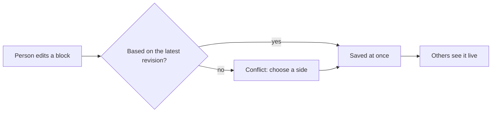

# Rich blocks

Only AI agents write these blocks. The UI draws each one inside a sandboxed frame, so the HTML and SVG cannot reach the rest of the page.

## Mermaid



## SVG

```svg
<svg xmlns="http://www.w3.org/2000/svg" viewBox="0 0 360 120" font-family="system-ui, sans-serif" font-size="13">
  <rect x="10" y="30" width="100" height="60" rx="8" fill="#eaf0fc" stroke="#2350c8"/>
  <text x="60" y="65" text-anchor="middle" fill="#1a2230">Workspace</text>
  <rect x="130" y="30" width="100" height="60" rx="8" fill="#f3ecfb" stroke="#7b3fc4"/>
  <text x="180" y="65" text-anchor="middle" fill="#1a2230">Paper</text>
  <rect x="250" y="30" width="100" height="60" rx="8" fill="#e7f6ee" stroke="#2e9e66"/>
  <text x="300" y="65" text-anchor="middle" fill="#1a2230">Block</text>
  <path d="M110 60 H128 M230 60 H248" stroke="#4a5566" stroke-width="2"/>
</svg>
```

## HTML

```html
<div style="font-family:system-ui,sans-serif;display:grid;grid-template-columns:repeat(3,1fr);gap:10px">
  <div style="padding:14px;border-radius:8px;background:#eaf0fc"><div style="font-size:12px;color:#4a5566">Open questions</div><div style="font-size:28px;font-weight:600;color:#1a2230">4</div></div>
  <div style="padding:14px;border-radius:8px;background:#f3ecfb"><div style="font-size:12px;color:#4a5566">Decisions this week</div><div style="font-size:28px;font-weight:600;color:#1a2230">7</div></div>
  <div style="padding:14px;border-radius:8px;background:#fdf3e3"><div style="font-size:12px;color:#4a5566">Papers updated</div><div style="font-size:28px;font-weight:600;color:#1a2230">23</div></div>
</div>
<div id="bar" style="margin-top:14px;height:10px;border-radius:5px;background:#dde2e9;overflow:hidden"><div style="width:0;height:100%;background:#7b3fc4;transition:width 1.2s"></div></div>
<div style="font:12px system-ui,sans-serif;color:#4a5566;margin-top:4px">Review progress 64% (this frame runs its own script)</div>
<script>setTimeout(function(){document.querySelector('#bar div').style.width='64%'},300)</script>
```
