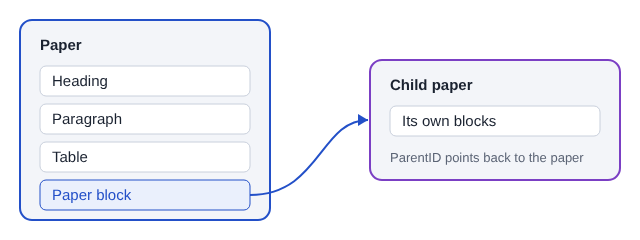

# What a paper is

A paper is an ordered list of **blocks**, with a title and an optional emoji icon shown before the title in the sidebar, lists and links. A paper without an icon shows one for its kind: 📄 for a paper, 🗃️ for a database, 🧩 for an HTML paper and 🧭 for the home. Each block is one paragraph, heading, list item, table or diagram, and people and AI agents rewrite the same paper block by block. Text can be *emphasised*, **bold**, ~~struck out~~, `code`, [red]{.red} or [highlighted]{.bg-yellow}, and can [link to the MCP endpoint](/mcp). Type @ to mention a person, like [@Alex Chen]{user=0Ud2lz0GcCaMILz7tUH0us}: a click on the mention opens a card that lists the papers they created.

> [!NOTE]
> Everything here is sample content. Change anything; nothing else depends on it.

## How writing works

- Every write changes the current state at once; there is no draft.
- Each block has a revision. A write based on an older revision of a block someone else changed is a conflict, shown with both versions.
  - Resolve it by keeping one side, or merge the two by hand.
- There are no locks: anyone may edit any block at any time.

## Try it

1. Click a paragraph and type.
2. Press `/` at the start of an empty block to pick a block type.
3. Press Save version to keep this state as v1, then open the history to compare.

- [x] Open the sample papers
- [ ] Create a paper of your own and give it an icon (Add icon above the title)
- [ ] Open the Product roadmap database and add an item
- [ ] Ask an AI agent to summarise this one

> A paper is never finished; it is the current state of what the team knows.

---

## Blocks at a glance

| Block | Who writes it | Example |
| --- | --- | --- |
| Paragraph, list, table | People and AI | This paper |
| Mermaid, SVG, HTML | AI only | Diagrams and rich blocks |
| HTML paper | AI only | Release dashboard |

```bash
# Replace the data of a Firestore database with these samples
papers firestore reset --demo --firestore-project-id my-project \
  --config examples/config --attachment-backend dir --attachment-dir ./attachments
```


